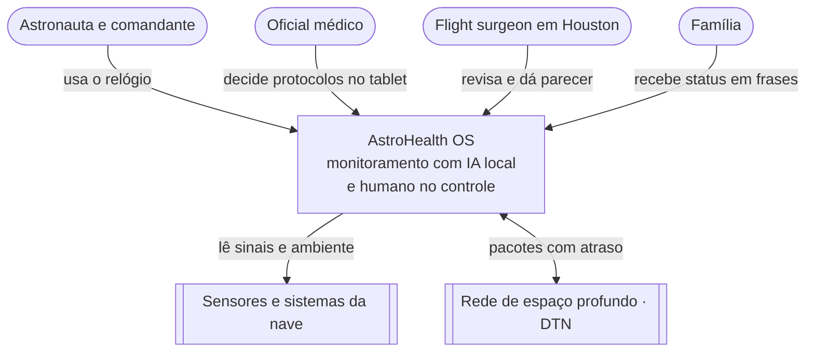
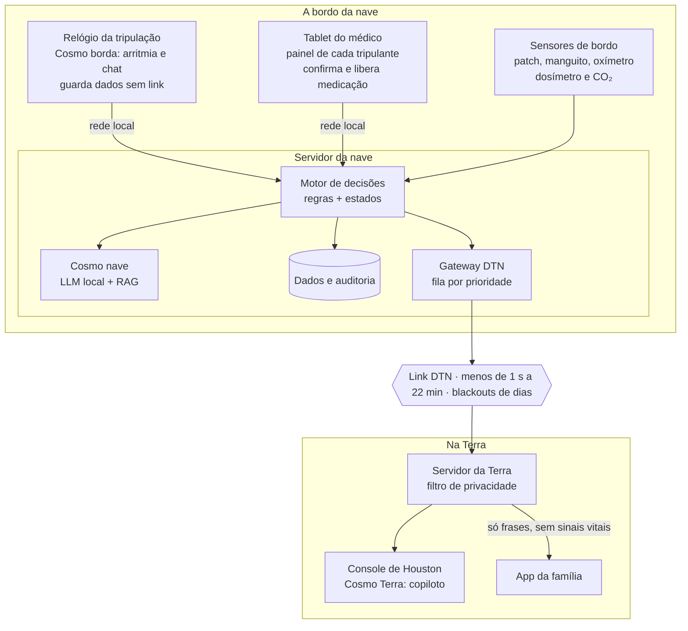
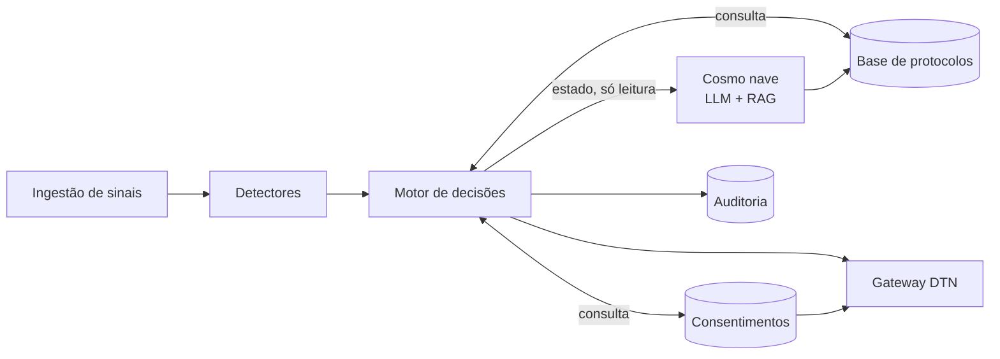

# 3. Arquitetura C4

Tudo o que protege a vida roda na nave; só o gateway DTN atravessa para a Terra. O motor de decisões é o único componente que muda o estado de um evento.

## Nível 1 · Contexto

## Nível 2 · Containers

## Nível 3 · Componentes do servidor da nave

| Componente | Responsabilidade | Fala com |
| --- | --- | --- |
| Ingestão de sinais | Recebe leituras, marca fonte, hora e qualidade do sinal | Relógios, sensores, motor de decisões |
| Detectores | Modelos pequenos: arritmia, hipóxia, artefato de sensor, prontidão, humor e linha de base. O z robusto classifica cada sinal; o Isolation Forest, um modelo por tripulante, marca a combinação fora do padrão ([ADR-012](../adr/0012-linha-de-base-com-isolation-forest.md)) | Ingestão, motor de decisões |
| Motor de decisões | Abre eventos, aplica o nível de autonomia, chama o humano responsável, escala por tempo | Detectores, apps, auditoria, gateway |
| Cosmo nave (LLM + RAG) | Conversa, explica evidências e resume; não muda estado | Motor de decisões (só leitura), apps |
| Base de protocolos | Protocolos médicos, manual do kit, estoque e validade de medicamentos | Cosmo nave, motor de decisões |
| Consentimentos | Quem autorizou o quê, para quem, até quando | Motor de decisões, gateway |
| Auditoria | Log só de inclusão com hash encadeado | Todos os componentes (escrita) |
| Gateway DTN | Monta pacotes, aplica prioridade e consentimento, guarda no blackout | Motor de decisões, link DTN |

No relógio roda uma versão reduzida: ingestão, detector de arritmia e de artefato, chat básico e fila local. Assim, um alerta crítico não depende nem do servidor da nave.
