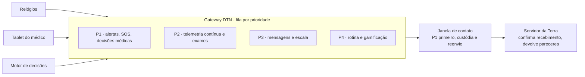

# 4. Implantação e comunicação

Dentro da nave, tudo conversa pela rede local em milissegundos. Para fora, os dados viajam em pacotes DTN, guardados e reenviados até chegar, sempre na ordem de prioridade.

**Blackout:** a fila guarda tudo; P1 nunca é descartado; P4 pode virar um resumo. Cada pacote carrega a hora em que foi gerado ([ADR-006](../adr/0006-terra-ve-snapshots-atrasados.md)).

## Nós de implantação

| Nó | Onde roda | Comunicação |
| --- | --- | --- |
| Relógio | Pulso de cada tripulante | Rede local da nave (BLE ou Wi-Fi); guarda dados se o servidor cair |
| Tablet | Enfermaria, com o oficial médico | Wi-Fi da nave |
| Servidor da nave | Computador de bordo, com dois nós redundantes | Rede local para dentro; DTN para fora |
| Servidor da Terra | Data center em Houston | DTN para a nave; HTTPS para o console e o app |
| Console de Houston | Sala do flight surgeon | HTTPS, com autenticação forte |
| App da família | Celular da família | HTTPS, só o feed já filtrado |

## Perfis de missão

O mesmo software se ajusta ao atraso. O perfil muda quem decide primeiro, não o código.

| Perfil | Atraso de ida | Link | Quem decide primeiro |
| --- | --- | --- | --- |
| ISS · órbita baixa | Menos de 1 s | Satélites TDRS | Houston junto com a tripulação |
| Gateway · órbita lunar | Cerca de 1,3 s | Deep Space Network | Tripulação, com Houston em segundos |
| Trânsito para Marte | 3 a 22 min, conforme a posição dos planetas | Deep Space Network | Tripulação; Houston revisa depois |
| Superfície de Marte | 3 a 22 min | Orbitador de relay + DSN | Tripulação; Houston revisa depois |

Referência: [NASA · Interplanetary Overlay Network (DTN)](https://www.nasa.gov/space-communications-navigation/interplanetary-overlay-network/).
