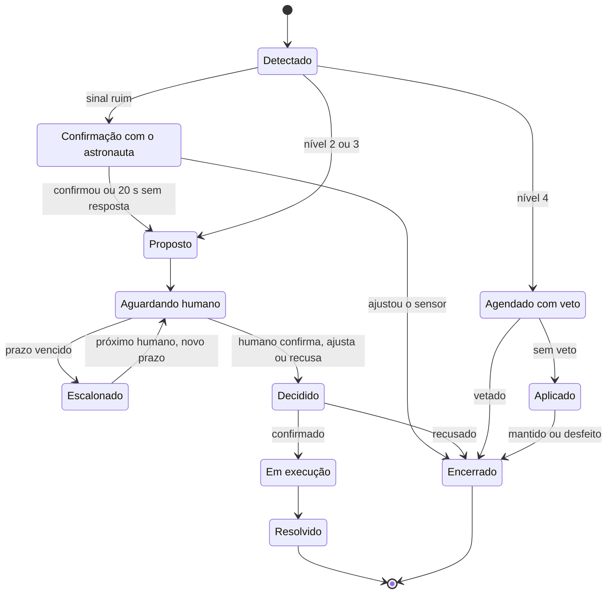

# 5. Motor de decisões com humano no controle

Todo evento de saúde vira uma máquina de estados com um humano responsável. A IA só age sozinha em ações urgentes e reversíveis, e mesmo assim o humano pode desfazer.

## Níveis de autonomia

| Nível | O que a Cosmo faz | Exemplos na demo |
| --- | --- | --- |
| 0 · Observar | Registra e aprende o padrão de cada tripulante | Linha de base de FC, sono e HRV |
| 1 · Informar | Avisa, sem recomendar nada | Dose de radiação do dia, tendência de sono, combinação de sinais fora do padrão |
| 2 · Sugerir | Propõe; o humano decide | Beber água, respirar, treino mais leve no trecho do ciclo, prontidão para EVA |
| 3 · Preparar e pedir confirmação | Deixa tudo pronto e executa após um toque | Protocolo de emergência, abrigo, ultrassom guiado |
| 4 · Agir e avisar, com desfazer | Executa ações urgentes e reversíveis | Rota até o abrigo, modo noite, SOS na frente da fila |
| Nunca sozinha | Sempre exige um humano | Medicação, procedimentos invasivos, compartilhar saúde mental ou o ciclo, tirar alguém de tarefa crítica |

## Linha de base no motor

O estado de três níveis sai do z robusto, sinal por sinal. O Isolation Forest não altera esse estado nem abre evento clínico. Ele vira sugestão de nível 1 só quando marca anomalia, o M2 classifica o sinal como bom e nenhum sinal está crítico sozinho. Se o M1 já abriu fibrilação atrial, ou se um sinal está crítico, permanece o evento aberto. A família não recebe escore nem faixa. O modelo está na [ADR-012](../adr/0012-linha-de-base-com-isolation-forest.md).

## Calendário do ciclo no motor

A ficha de cada tripulante escolhe a direção. Com calendário, o relógio avisa só essa pessoa cerca de dois dias antes do trecho intenso. Sem calendário, a pergunta de cólica não abre e a Cosmo fica na linha de base pessoal. Na demo, Sarah e Elena têm calendário; Marcus e Kenji não têm. O da Elena não aparece no painel até ela autorizar. O relógio fala dos sintomas (cólica, inchaço ou humor), não do método. O método só entra quando a Cosmo precisa explicar: com supressão, o trecho não é ovulação; sem método, a janela segue a última menstruação. A pergunta só sai quando esse trecho coincide com sinais leves e o M2 classifica o sinal como bom. O cuidado é nível 2. O estado de três níveis não muda. Analgésico do kit fica com o oficial médico, em passo separado. Médico e Houston só veem com consentimento. A família não recebe fase, calendário, método nem sintoma. A decisão está na [ADR-013](../adr/0013-calendario-do-ciclo.md).

## Quem decide cada tipo de evento

Os prazos são metas de projeto, a validar com o time médico.

| Tipo de decisão | Humano responsável | Prazo para responder | Sem resposta, vai para |
| --- | --- | --- | --- |
| Leitura suspeita do sensor | O próprio astronauta | 20 s | Oficial médico |
| Protocolo clínico | Oficial médico | 60 s | Comandante e tripulante com treino médico |
| Medicação | Oficial médico | Sem escalonamento automático | Oficial médico substituto |
| Abrigo contra radiação | Comandante | 2 min | Próximo na cadeia de comando |
| Escala de tarefa crítica | Comandante | Até o início da tarefa | Próximo na cadeia de comando |
| Compartilhar saúde mental | O próprio astronauta | Não escala | Ninguém; exceção só em risco de vida |
| Compartilhar o ciclo | A própria astronauta | Não escala | Ninguém; a família não recebe |
| Ação de nível 4 | O próprio astronauta, por veto | 15 s para vetar | Aplica e oferece desfazer |

## Estados de um evento

Cada transição grava na auditoria: evento, estado anterior e novo, quem decidiu, quando, versão do modelo e evidências usadas. O escalonamento sempre aponta para outro humano, nunca para a IA ([ADR-004](../adr/0004-humano-responsavel-e-escalonamento.md)).
