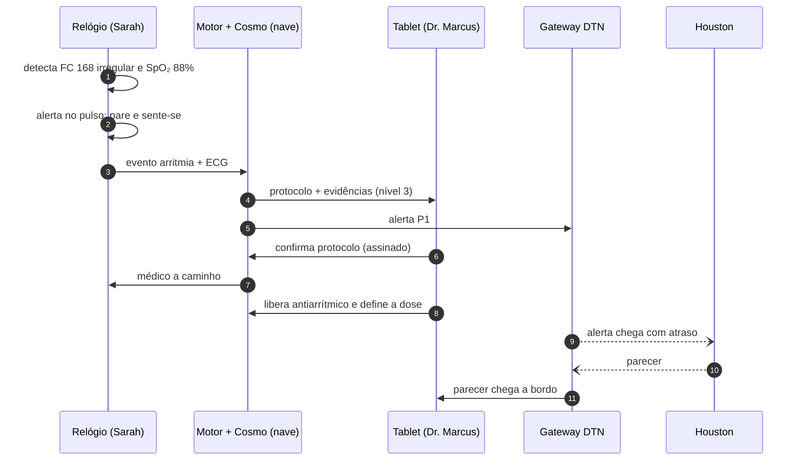
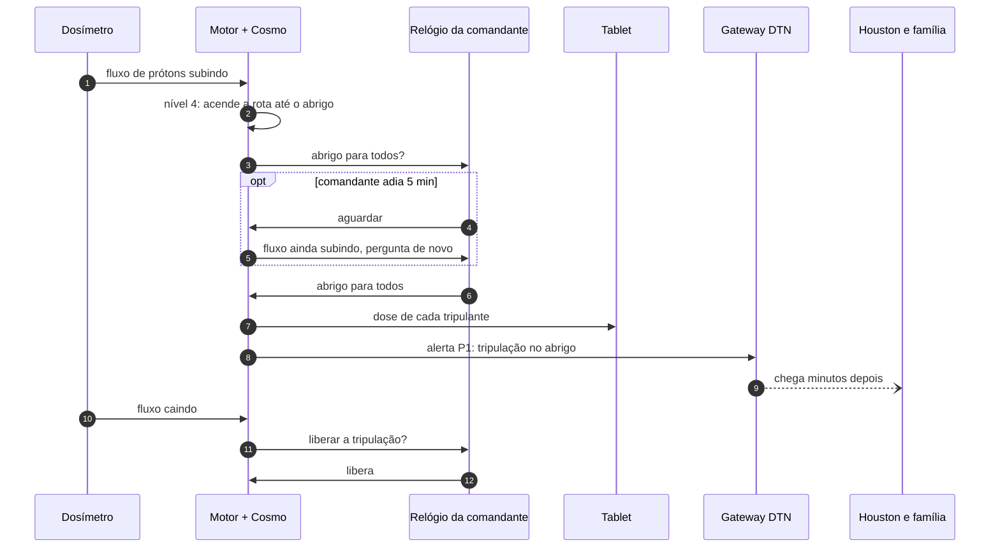
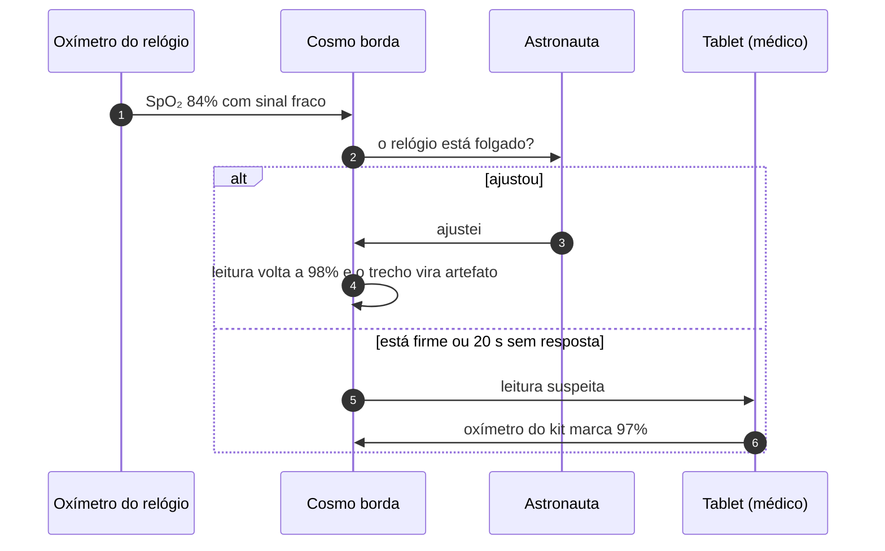
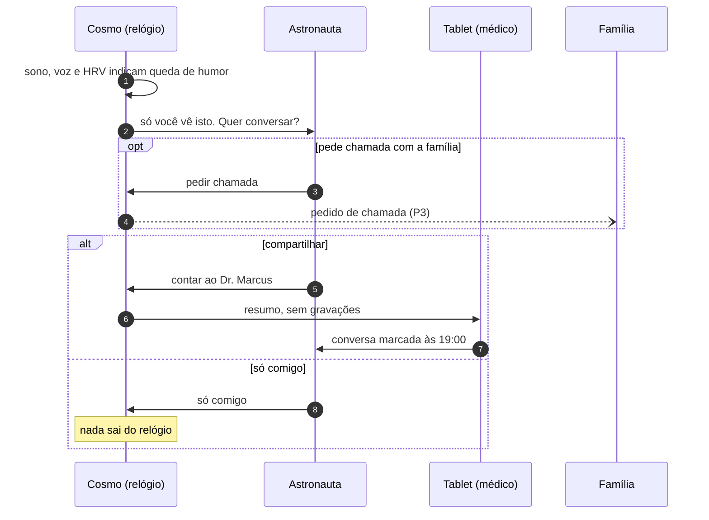
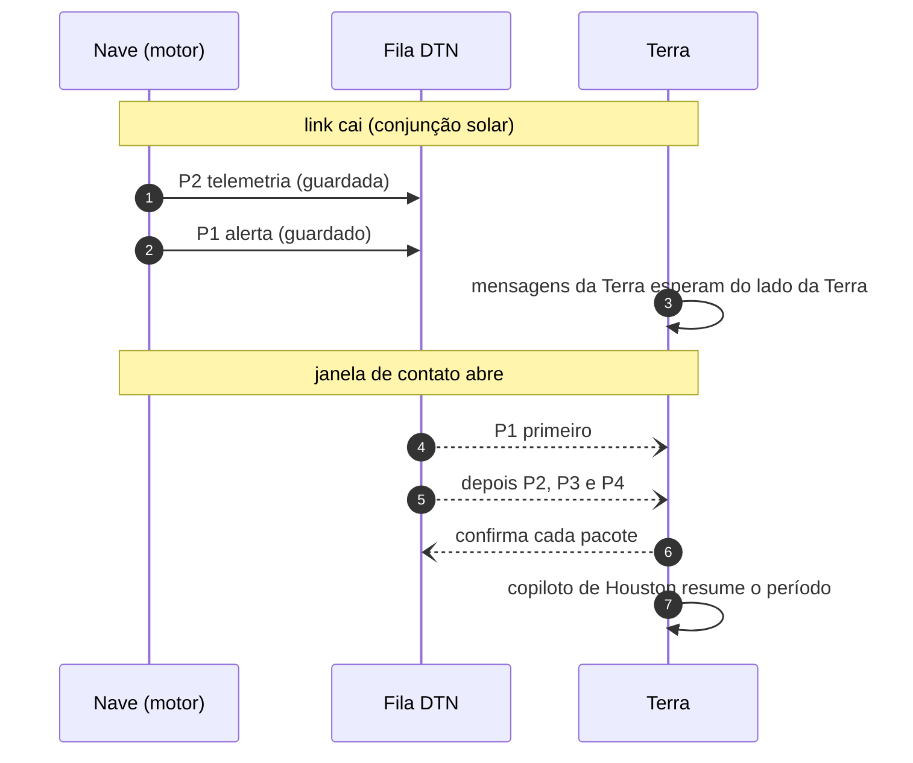

# 6. Fluxos principais

Nos cinco fluxos, a decisão acontece a bordo, e a Terra fica sabendo depois. Setas `--)` cruzam o link com a Terra e levam de menos de 1 s a 22 min, conforme o perfil de missão.

## Emergência cardíaca

## Tempestade solar

## Sensor solto

## Saúde mental com consentimento

## Blackout e volta do sinal

