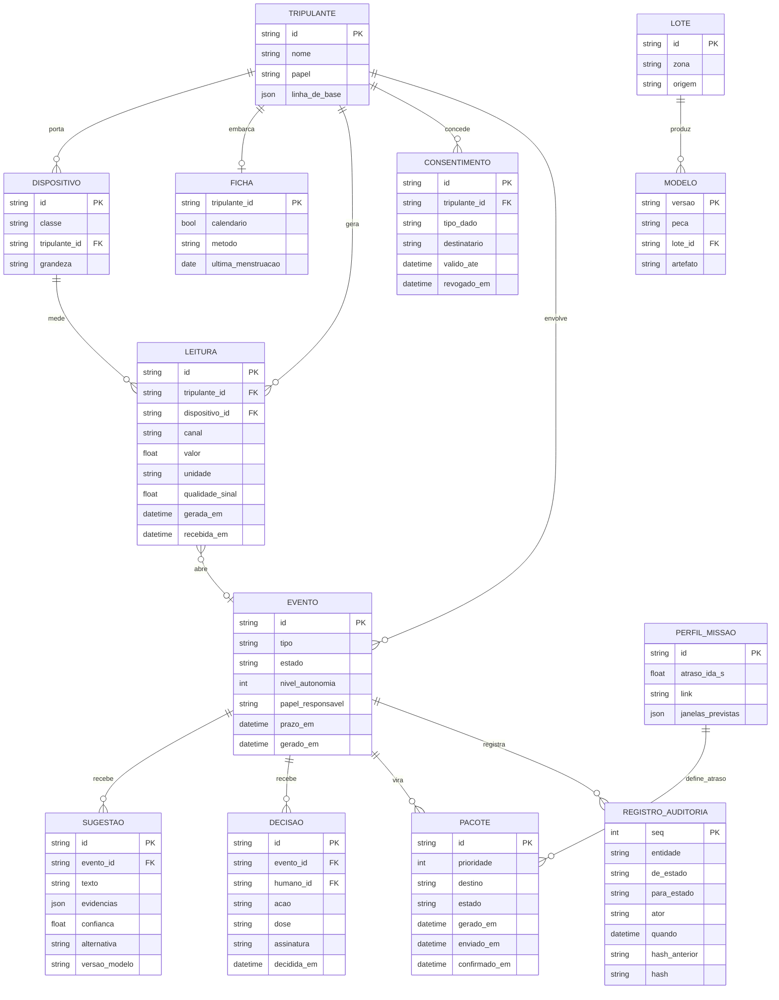
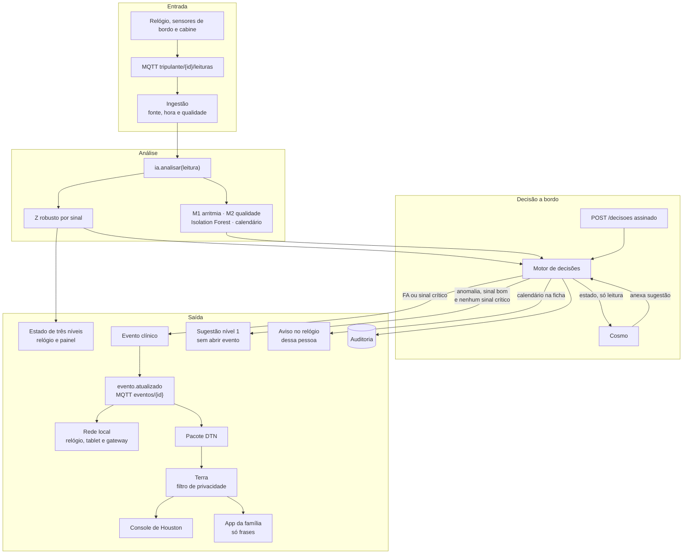

# 7. Modelo de dados e contratos

O centro do modelo é o Evento: leituras abrem eventos, a Cosmo anexa sugestões e só humanos registram decisões. Toda entidade carrega a hora em que foi gerada; a Terra acrescenta a hora em que recebeu.

`DISPOSITIVO.classe` é `relogio`, `patch`, `kit`, `cabine` ou `registro`. O CO₂ da cabine não tem tripulante: `tripulante_id` fica vazio e a leitura continua válida. A dose do dosímetro é da pessoa. A ficha de solo não é uma leitura. Estresse não é sensor: sai na zona prata, a partir de HRV e sono. O caminho dessas leituras até o lakehouse, o tratamento e o treino estão em [11-dados-lakehouse.md](11-dados-lakehouse.md).

## Ingestão e saída

A leitura entra pelo tópico MQTT. A ingestão grava fonte, hora e qualidade, e o `ia.py` devolve a análise. O z robusto pinta o estado no relógio e no painel. O motor escolhe o restante da saída. A Cosmo só lê esse estado e anexa a sugestão. O humano devolve a decisão assinada.

A sugestão de nível 1 sai quando o Isolation Forest marca anomalia, o M2 diz que o sinal é bom e nenhum sinal está crítico sozinho. Se o M1 já abriu fibrilação atrial, ou se um sinal está crítico, permanece o evento aberto, no contrato `evento.atualizado`. Com calendário na ficha, o aviso do trecho intenso fica no relógio dessa pessoa. A Terra recebe o pacote DTN e aplica o filtro: Houston vê o necessário para o parecer, e a família recebe frases prontas, sem escore, faixa ou ciclo. No relógio, com o servidor fora, seguem a ingestão, o detector de arritmia, o de artefato e a fila local.

## Regras de escrita

- **Sugestão:** escrita só pela Cosmo; nunca muda o estado do evento.
- **Decisão:** escrita só por humanos, sempre assinada.
- **Registro de auditoria:** só inclusão; cada registro guarda o hash do anterior.

## Contrato `evento.atualizado`

O mesmo formato vai para o tablet pela rede local e para a Terra num pacote DTN. Schema em [contratos/evento-atualizado.schema.json](../contratos/evento-atualizado.schema.json); exemplo em [contratos/exemplos/evento-arritmia.json](../contratos/exemplos/evento-arritmia.json).

## Análise dos modelos

O `ia.py` devolve M1, M2 e M3 no formato de [contratos/exemplos/analise-fa.json](../contratos/exemplos/analise-fa.json). Os números desse arquivo são ilustrativos, até o treino do sábado. Em `m3.metricas`, cada sinal traz o z robusto e a faixa (`padrao`, `atencao`, `critico`). Em `m3.isolation_forest`, `score` é o `-score_samples` depois do `RobustScaler` daquela pessoa: quanto maior, mais a combinação se afasta do padrão dela. `evidencias` lista os sinais cuja troca pela mediana mais reduz esse escore. Quem decide se isso vira sugestão é o motor, pela [ADR-012](../adr/0012-linha-de-base-com-isolation-forest.md).

O calendário do ciclo sai no formato de [contratos/exemplos/analise-ciclo.json](../contratos/exemplos/analise-ciclo.json). Os números também são ilustrativos. `ficha.calendario` diz se a Cosmo pode falar de ciclo. `ciclo.na_janela` e `ciclo.aviso_dias` vêm dessa ficha. `ciclo.perguntar` só fica verdadeiro quando a janela coincide com sinais leves e o M2 diz que o sinal é bom. `ciclo.compartilhado` começa falso: médico e Houston só entram depois do consentimento. A família não está nesse contrato.

Quem não tem calendário sai no formato de [contratos/exemplos/analise-kenji.json](../contratos/exemplos/analise-kenji.json). `ciclo` fica nulo e a sugestão usa a linha de base pessoal. A regra dos dois caminhos está na [ADR-013](../adr/0013-calendario-do-ciclo.md).

## Interfaces do protótipo

| Interface | Tipo | Quem publica ou chama | Quem consome |
| --- | --- | --- | --- |
| `tripulante/{id}/leituras` | Tópico MQTT | Relógio, sensores | Ingestão, detectores |
| `eventos/{id}` | Tópico MQTT | Motor de decisões | Relógio, tablet, gateway |
| `POST /decisoes` | REST (FastAPI) | Relógio, tablet (assinado) | Motor de decisões |
| `POST /consentimentos` | REST | Relógio | Motor, gateway |
| `POST /cosmo/chat` | REST | Relógio, tablet, console | Cosmo (nave ou Terra) |
| `GET /familia/feed` | REST, só na Terra | App da família | Filtro de privacidade |
