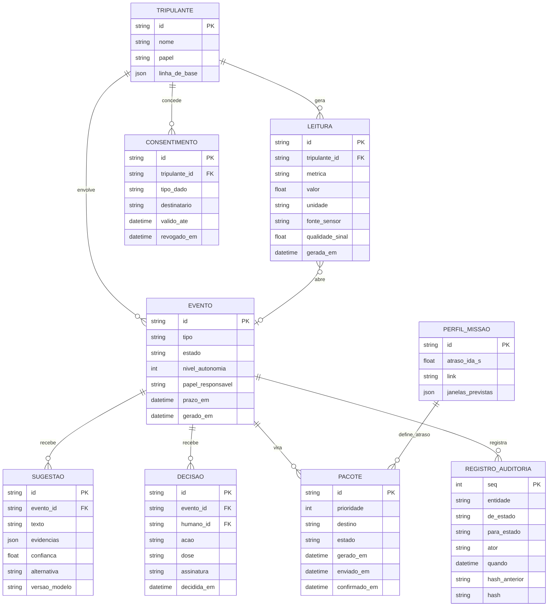

# 7. Modelo de dados e contratos

O centro do modelo é o Evento: leituras abrem eventos, a Cosmo anexa sugestões e só humanos registram decisões. Toda entidade carrega a hora em que foi gerada; a Terra acrescenta a hora em que recebeu.

## Regras de escrita

- **Sugestão:** escrita só pela Cosmo; nunca muda o estado do evento.
- **Decisão:** escrita só por humanos, sempre assinada.
- **Registro de auditoria:** só inclusão; cada registro guarda o hash do anterior.

## Contrato `evento.atualizado`

O mesmo formato vai para o tablet pela rede local e para a Terra num pacote DTN. Schema em [contratos/evento-atualizado.schema.json](../contratos/evento-atualizado.schema.json); exemplo em [contratos/exemplos/evento-arritmia.json](../contratos/exemplos/evento-arritmia.json).

## Análise dos modelos

O `ia.py` devolve M1, M2 e M3 no formato de [contratos/exemplos/analise-fa.json](../contratos/exemplos/analise-fa.json). Os números desse arquivo são ilustrativos, até o treino do sábado. Em `m3.metricas`, cada sinal traz o z robusto e a faixa (`padrao`, `atencao`, `critico`). Em `m3.isolation_forest`, `score` é o `-score_samples` depois do `RobustScaler` daquela pessoa: quanto maior, mais a combinação se afasta do padrão dela. `evidencias` lista os sinais cuja troca pela mediana mais reduz esse escore. Quem decide se isso vira sugestão é o motor, pela [ADR-012](../adr/0012-linha-de-base-com-isolation-forest.md).

## Interfaces do protótipo

| Interface | Tipo | Quem publica ou chama | Quem consome |
| --- | --- | --- | --- |
| `tripulante/{id}/leituras` | Tópico MQTT | Relógio, sensores | Ingestão, detectores |
| `eventos/{id}` | Tópico MQTT | Motor de decisões | Relógio, tablet, gateway |
| `POST /decisoes` | REST (FastAPI) | Relógio, tablet (assinado) | Motor de decisões |
| `POST /consentimentos` | REST | Relógio | Motor, gateway |
| `POST /cosmo/chat` | REST | Relógio, tablet, console | Cosmo (nave ou Terra) |
| `GET /familia/feed` | REST, só na Terra | App da família | Filtro de privacidade |
