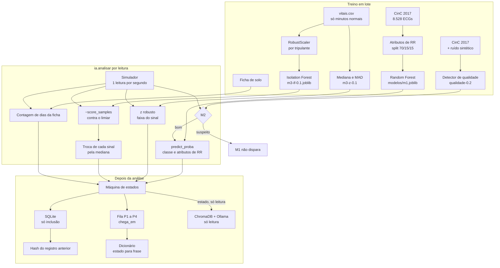

# 8. Stack híbrida

Os diagramas descrevem o sistema como ele seria numa nave real. O protótipo do hackathon implementa as mesmas fronteiras com a stack que o time já domina. Regra para as duas colunas: o LLM conversa, explica e resume, mas quem decide o estado de um evento é o motor de decisões determinístico.

| Camada | Referência para produção (padrão NASA) | Protótipo do hackathon |
| --- | --- | --- |
| Relógio (borda) | Wear OS, watchOS ou firmware dedicado; modelos pequenos quantizados (TFLite/LiteRT, ONNX) para arritmia e qualidade de sinal | Relógio simulado na demo web; modelos em Python com ONNX Runtime ou scikit-learn |
| Rede local da nave | Wi-Fi e BLE da nave; mensageria com QoS e autenticação mútua | MQTT (Mosquitto) ou WebSocket local |
| Cosmo nave | LLM local quantizado + RAG sobre protocolos médicos e manual do kit, sem internet | Python + FastAPI; LangChain ou CrewAI; ChromaDB com os protocolos; LLM local via Ollama |
| Motor de decisões | Regras + máquina de estados determinística, certificável e testável | Python com máquina de estados (biblioteca transitions ou própria) |
| Armazenamento | Banco embarcado + log de auditoria só de inclusão, com hash encadeado | SQLite + tabela de eventos só de inclusão |
| Link nave ⇄ Terra | DTN com Bundle Protocol (por exemplo, o ION da NASA), custódia e prioridade | Simulador de atraso em Python: fila por prioridade e atraso configurável por perfil de missão |
| Cosmo Terra (Houston) | Modelos maiores, inclusive em nuvem, sob regras para dados de saúde | FastAPI + LangChain; API da OpenAI permitida só aqui, nunca a bordo |
| App da família | App móvel; filtro de privacidade aplicado no servidor da Terra | Página web responsiva, como na demo |
| Testes | Testes de cenário e de tempo real | Robot Framework para aceitação dos fluxos + pytest nas regras |

**Por que híbrida:** a banca vê uma arquitetura plausível para uma nave real, e o time entrega código funcionando em 48 h. Trocar o simulador pelo ION ou o relógio simulado por um real não muda as fronteiras entre os componentes ([ADR-011](../adr/0011-stack-hibrida.md)).

## Linha de base no protótipo (M3)

O M3 roda no `ia.py`, no servidor da nave, com scikit-learn. O relógio recebe o estado de três níveis; a floresta não roda no pulso.

- **Z robusto:** mediana e MAD de cada tripulante, por sinal. Isso pinta o avatar e cada indicador do painel.
- **Isolation Forest (`m3-if-0.1`):** um modelo por tripulante, treinado só nos minutos normais de `dados/vitais.csv`. O pipeline leva um `RobustScaler` daquela pessoa e depois a floresta. O limiar cabe em no máximo 1 alarme por pessoa por dia simulado. A explicação troca cada sinal pela mediana e fica com os que mais reduzem o escore.

As duas peças saem juntas em `analisar(leitura)`. O escore não substitui a faixa de cada sinal. A regra de quando o motor abre sugestão de nível 1 está na [ADR-012](../adr/0012-linha-de-base-com-isolation-forest.md). O exemplo de resposta, no quadro de fibrilação atrial da Sarah, está em [contratos/exemplos/analise-fa.json](../contratos/exemplos/analise-fa.json).

O calendário do ciclo também sai de `analisar(leitura)`, ao lado do M3, só quando `ficha.calendario` é verdadeiro. Sem calendário, `ciclo` fica nulo e a sugestão usa a linha de base pessoal, como em [contratos/exemplos/analise-kenji.json](../contratos/exemplos/analise-kenji.json). A previsão, quando existe, conta os dias da ficha de solo e, se a pessoa não está em supressão, ajusta a janela quando a frequência e a temperatura da pele sobem no padrão dela. Não é um classificador de fase. O exemplo com calendário está em [contratos/exemplos/analise-ciclo.json](../contratos/exemplos/analise-ciclo.json), e a regra na [ADR-013](../adr/0013-calendario-do-ciclo.md).

## Pipeline de dados e algoritmos

O treino fica em lote, lê a zona ouro e grava artefatos. A chegada do relógio e dos outros sensores ao lakehouse, e o tratamento antes do ouro, estão na [seção 11](11-dados-lakehouse.md). Cada leitura do simulador, uma por segundo, só passa por `ia.analisar(leitura)`. O motor, o hash e a fila não aprendem. O M2 ainda não tem o estimador escolhido: o plano fixa o dado, o rótulo e o recall.



| Peça | Algoritmo | Entrada | Saída |
| --- | --- | --- | --- |
| M1 `arritmia-borda-0.3` | Random Forest sobre atributos de RR. Guarda a probabilidade e os 3 atributos que mais pesaram | CinC 2017, split 70/15/15. Meta: F1 da classe FA ≥ 0,75 | `classe`, `confianca`, atributos de RR em `modelos/m1.joblib` |
| M2 `qualidade-0.2` | Detector de qualidade. O estimador ainda não está escolhido | CinC 2017 com ruído sintético. Meta: recall de `suspeito` ≥ 0,9 | `bom` ou `suspeito`. Com sinal suspeito, o M1 não dispara |
| M3 z `m3-z-0.1` | Mediana e MAD de cada tripulante, por sinal | Minutos dos vitais sintéticos | Faixa `padrao`, `atencao` ou `critico`. A soma vira o estado de três níveis |
| M3 floresta `m3-if-0.1` | `RobustScaler` da pessoa e, em seguida, Isolation Forest. Um modelo por tripulante | Só os minutos normais de `dados/vitais.csv`. Cenários de FA e de relógio folgado ficam fora | `−score_samples`. O limiar, na validação, cabe em no máximo 1 alarme por pessoa por dia simulado |
| Evidência da floresta | Troca cada sinal pela mediana da pessoa e mede a queda do escore | Vetor já escalado daquela leitura | `evidencias`: os sinais que mais reduzem o escore |
| Ciclo `ciclo-calendario-0.1` | Contagem de dias da ficha. Sem supressão, a janela se ajusta quando FC e temperatura da pele sobem no padrão dela | Ficha de solo. Não é classificador de fase | `na_janela`, `aviso_dias`. Sem calendário, `ciclo` fica nulo |
| Motor | Máquina de estados determinística, biblioteca `transitions` ou dicionário próprio | JSON do `ia.analisar` e as regras da [ADR-012](../adr/0012-linha-de-base-com-isolation-forest.md) e da [ADR-013](../adr/0013-calendario-do-ciclo.md) | Estado do evento. A Cosmo não escreve nesse estado |
| Cosmo | Busca no ChromaDB e geração no Ollama, pela LangChain ou CrewAI | Protocolos indexados e o estado, só para leitura | Texto com a fonte citada. Nenhuma rota que muda estado |
| Auditoria | Hash do registro anterior, só inclusão | Transição, sugestão, decisão e escalonamento | Trilha no SQLite, copiada para a Terra em P2 |
| Link | Fila por prioridade. `chega_em = agora + atraso` do perfil de missão | `evento.atualizado` | P1 a P4. O feed da família sai de um dicionário de estado para frase |

## Estrutura sugerida do código do protótipo

```text
astrohealth/
├── nave/
│   ├── ingestao/          # leituras + qualidade de sinal
│   ├── detectores/        # arritmia, artefato, linha de base (z e Isolation Forest), calendário do ciclo, prontidão, humor
│   ├── motor/             # máquina de estados + regras + prazos
│   ├── cosmo/             # LangChain/CrewAI + ChromaDB + Ollama
│   ├── auditoria/         # log com hash encadeado (SQLite)
│   └── gateway_dtn/       # fila por prioridade + simulador de atraso
├── terra/
│   ├── servidor/          # recepção, confirmação, filtro de privacidade
│   └── cosmo_terra/       # copiloto de Houston
├── apps/                  # relógio, tablet, console, família (web)
├── dados/
│   ├── bronze/            # cru: relógio, sensores, CinC, sintético, ficha
│   ├── prata/             # tratado: unidade, relógio alinhado, qualidade
│   ├── ouro/              # uma tabela por modelo
│   └── treino/            # jobs que gravam modelos/*.joblib
├── contratos/             # JSON Schemas compartilhados
└── testes/
    ├── aceitacao/         # Robot Framework, um .robot por fluxo
    └── unidade/           # pytest
```
