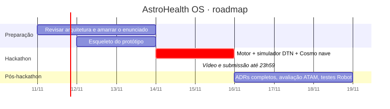

# 10. Roadmap, riscos e próximos passos

O MVP precisa dos 16 requisitos essenciais funcionando até o fechamento das submissões, em 15/11 às 23:59. A versão acadêmica, para a pós, fica para a semana seguinte.

O que a demo atual já mostra não precisa ser reimplementado no hackathon. O código novo são o motor de decisões, o simulador DTN e a Cosmo nave com RAG.

## Riscos

| Risco | Efeito | Mitigação |
| --- | --- | --- |
| O enunciado cobra algo fora deste escopo | Retrabalho no meio do evento | Colar o enunciado e os critérios antes de 13/11 e cruzar com os requisitos |
| LLM local lento no notebook do evento | A demo trava na frente da banca | Modelo pequeno e quantizado; respostas prontas como alternativa |
| Escopo grande para 48 h | MVP incompleto | Só os 16 requisitos essenciais; o resto fica na demo atual |
| Conselho médico errado ou exagerado | Perda de credibilidade | Protocolos de fontes públicas, aviso de que não é dispositivo médico, humano sempre decide |
| Integração MQTT e web atrasa | Fluxos não fecham ponta a ponta | WebSocket direto como plano B |

## Próximos passos

- [ ] Colar o enunciado oficial e os critérios de avaliação em `docs/01-visao-geral.md`
- [ ] Dividir o time por container: motor, Cosmo nave, simulador DTN, front
- [ ] Criar o repositório a partir desta pasta
- [ ] Escrever os testes de aceitação dos fluxos de emergência e de sensor solto
- [ ] Montar a base de protocolos médicos para o RAG

## Fontes

- [NASA Human Research Program: os cinco perigos (RIDGE)](https://www.nasa.gov/hrp/hazards)
- [NASA Space Apps Challenge 2026](https://www.spaceappschallenge.org/2026/)
- [Desafio: Create Health Monitoring Software for Astronauts…](https://www.spaceappschallenge.org/2026/challenges/health-monitoring-software/)
- [NASA: Interplanetary Overlay Network (DTN)](https://www.nasa.gov/space-communications-navigation/interplanetary-overlay-network/)
