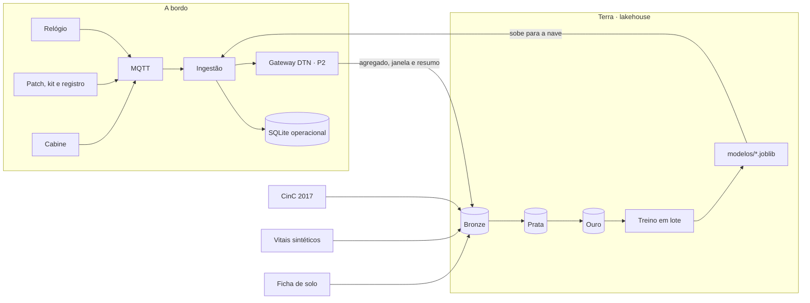

# 11. Dados: do sensor ao lakehouse

A NASA não publica o prontuário da tripulação. O treino deste projeto não espera esse arquivo. O que existe de aberto, e o que o time gera, entra no lakehouse com a origem escrita no lote. O lakehouse fica na Terra. A nave guarda o operacional no SQLite e manda para baixo só o que cabe no link.

## Duas origens, mais a cabine

O relógio não é o único sensor. Cada leitura carrega `dispositivo_id` e `canal`. A ficha de solo entra uma vez, antes do voo, e não é uma série temporal.

| Classe | Dispositivo | Canal | Cadência a bordo | Tripulante |
| --- | --- | --- | --- | --- |
| `relogio` | PPG e ECG curto | `fc`, `hrv`, trecho de ECG | 1 Hz; ECG só em janela | sim |
| `relogio` | Oxímetro do pulso | `spo2` | 1 Hz | sim |
| `relogio` | Temperatura da pele | `temp_pele` | 1 Hz | sim |
| `relogio` | Actigrafia | `sono` | resumo da noite | sim |
| `relogio` | Acelerômetro | `atividade` | 1 Hz | sim |
| `patch` | Patch torácico | `respiracao` | 1 Hz | sim |
| `kit` | Manguito | `pa` | sob demanda | sim |
| `kit` | Oxímetro de dedo | `spo2_kit` | sob demanda, para conferir o pulso | sim |
| `cabine` | Sensor de CO₂ | `co2` | 1 min | não |
| `cabine` | Dosímetro | `dose` | 1 min | sim, a dose é da pessoa |
| `registro` | Registro de água | `agua` | quando a pessoa marca | sim |
| ficha | Ficha de solo | calendário, método, última menstruação | uma vez | sim |

Estresse não nasce num sensor. A zona prata calcula esse canal a partir de HRV e sono. O estado de três níveis também é derivado, e não volta para o bronze como se fosse medida.

## O que atravessa o link

No pulso e no servidor da nave a leitura segue a 1 Hz, no tópico `tripulante/{id}/leituras`. Cabine publica o mesmo formato, com `tripulante_id` vazio no CO₂. Isso fica no SQLite da nave e alimenta o `ia.analisar`.

Para a Terra, o gateway não manda cada amostra de 1 Hz. O pacote P2 leva:

- agregado de 1 minuto dos canais contínuos, com mediana, mínimo, máximo e a fração de amostras que o M2 marcou como suspeitas;
- a janela crua de ECG quando um evento abre;
- o resumo da noite (sono e actigrafia);
- a ficha, uma vez, e de novo só se ela mudar.

P1 continua reservado a alerta, SOS e decisão. A família não lê o lakehouse. O filtro de privacidade segue na frente do app, como na [seção 7](07-modelo-de-dados.md).

No hackathon o simulador grava o mesmo contrato direto nas zonas de arquivo. O lote marca `origem` como `sintetico` ou `cinc`. Não há uma pasta `nasa`.

## Zonas

| Zona | Guarda | Escreve | Lê |
| --- | --- | --- | --- |
| Bronze | Payload cru, `dispositivo_id`, `canal`, hora gerada e hora recebida. Só inclusão | Gateway da Terra; no hackathon, o export do simulador e a cópia do CinC | Tratamento |
| Prata | Uma linha por canal, unidade única, relógio alinhado, qualidade do M2. Amostra suspeita permanece, com a marca | Job de tratamento | Ciência de dados e treino |
| Ouro | Uma tabela por peça de modelo, já com o corte de treino | Job de tratamento | Jobs de treino |

Amostra suspeita não entra no ouro. Ciclo, método e sintoma não entram em tabela de atributo. A ficha fica numa tabela à parte, com o mesmo consentimento da [ADR-013](../adr/0013-calendario-do-ciclo.md).

## Ciência de dados · tratamento

O job da prata faz, nesta ordem:

1. Confere unidade e faixa física. Fora da faixa, a linha fica na prata com `qualidade = suspeito` e não segue.
2. Alinha os relógios. Patch, manguito e pulso não amostram no mesmo instante. O minuto do agregado é a chave comum. A hora gerada a bordo prevalece sobre a hora em que a Terra recebeu.
3. Aplica o M2. Sinal suspeito, como o relógio folgado, não treina o M1 nem o Isolation Forest.
4. Calcula os canais derivados (estresse) só depois da qualidade.
5. Separa o que é de uma pessoa do que é da cabine. CO₂ não entra na linha de base do Kenji.
6. Monta o ouro com a regra de cada modelo, abaixo. Minutos de fibrilação e de sensor solto ficam de fora do `m3-if`, como na [ADR-012](../adr/0012-linha-de-base-com-isolation-forest.md).

Não há rótulo de fase menstrual nesse tratamento. O calendário conta dias da ficha. Sem supressão, a janela se ajusta quando a frequência e a temperatura da pele sobem no padrão daquela pessoa. Isso não é um classificador treinado.

## Engenharia de dados · treino

O treino é em lote. A leitura de 1 Hz na nave não atualiza peso nenhum. O motor, o hash e a fila não aprendem. Cada job lê uma tabela de ouro, grava um artefato com versão e registra o `lote_id`.

| Peça | Tabela de ouro | De onde vem o lote | Artefato |
| --- | --- | --- | --- |
| M1 `arritmia-borda-0.3` | Atributos de RR, split 70/15/15 | CinC 2017, 8.528 ECGs públicos, terrestres | `modelos/m1.joblib` |
| M2 `qualidade-0.2` | Os mesmos ECGs com ruído sintético e o rótulo `suspeito` | CinC 2017. O estimador ainda não está escolhido. Meta: recall de `suspeito` ≥ 0,9 | `modelos/m2.joblib` |
| M3 z `m3-z-0.1` | Minutos sintéticos por pessoa e por canal | Simulador. Mediana e MAD | parâmetros no `ia.py` |
| M3 floresta `m3-if-0.1` | Só minutos normais, um modelo por pessoa, `RobustScaler` antes da floresta | `dados/vitais.csv` sintético. Meta: no máximo 1 alarme por pessoa por dia simulado | `modelos/m3-if-0.1.joblib` |
| Ciclo `ciclo-calendario-0.1` | Ficha | Não há treino. A contagem de dias é regra | sem `.joblib` |

O artefato sobe para a nave. O lakehouse não sobe. Modelo novo entra em modo sombra e só troca o que está em serviço com aprovação médica, pela [ADR-010](../adr/0010-modelos-em-modo-sombra.md).

No protótipo as zonas são pastas (`dados/bronze`, `dados/prata`, `dados/ouro`) e os jobs são scripts em `dados/treino`. A fronteira é a mesma de um lakehouse de produção: bronze imutável, prata tratada, ouro por modelo, artefato versionado. Trocar a pasta por Delta ou Iceberg não muda o contrato da leitura nem o `ia.analisar`.
