AstroHealth OS · Arquitetura · Fase 2

[Documento](https://claude.ai/artifact/VAc7XDqgnsWmbqsZRo5kvB) · [Abrir a demo](https://claude.ai/artifact/CE5bxpHxaLhi8Af9SY7NmU)

## Índice

- [01 Visão geral](#visao)
- [02 Requisitos](#requisitos)
- [03 Arquitetura C4](#c4)
- [04 Implantação e comunicação](#comunicacao)
- [05 Motor de decisões](#decisoes)
- [06 Fluxos](#fluxos)
- [07 Modelo de dados](#dados)
- [Dados até o lakehouse](#lakehouse)
- [08 Stack híbrida](#stack)
- [09 Segurança e privacidade](#seguranca)
- [10 Roadmap e riscos](#roadmap)
- [11 Decisões (ADRs)](#adrs)

# A nave decide sozinha; a Terra recebe com atraso e revisa

Arquitetura do AstroHealth OS para a NASA Space Apps 2026: monitoramento da tripulação com IA local e um humano responsável por cada decisão clínica.

**26** requisitos · 16 essenciais · **11** atributos de qualidade · **14** diagramas · **11** ADRs · submissão **15/11 · 23:59**

> **Regra de ouro.** O LLM conversa, explica e resume. Só o motor de decisões determinístico muda o estado de um evento, e toda decisão clínica tem um humano responsável.

<a id="visao"></a>

## 01 · Visão geral

O AstroHealth OS monitora a saúde da tripulação a bordo e apoia decisões com um humano no controle, mesmo sem contato com a Terra. Esta arquitetura sai direto da demo navegável: cada fluxo dela vira requisito, componente e diagrama.

**Problema.** Quanto mais longe da Terra, maior o atraso e mais longos os períodos sem sinal. A caminho de Marte, cada mensagem leva minutos para chegar. Houston deixa de ser quem responde primeiro, e a nave precisa de medicina própria.

<a id="visao-escopo-desta-fase"></a>

### Escopo desta fase

- **Dentro:** monitoramento contínuo pelo relógio, IA local (Cosmo), motor de decisões com humano no controle, painel do oficial médico, console de Houston, app da família e comunicação tolerante a atraso.
- **Fora, por ora:** certificação médica, integração com o hardware real da nave e controle de sistemas de suporte de vida. Nesses sistemas a Cosmo só sugere; quem age é a engenharia.

<a id="visao-principios-de-arquitetura"></a>

### Princípios de arquitetura

1. **Offline primeiro:** tudo o que protege a vida roda a bordo, sem depender da Terra.
2. **Humano no controle:** a IA nunca toma sozinha uma decisão clínica ou irreversível.
3. **O humano certo decide:** astronauta, oficial médico ou comandante, conforme o tipo de decisão.
4. **Atraso é dado:** toda informação carrega quando foi gerada e quando chegou.
5. **Privacidade por padrão:** saúde mental só sai do relógio com consentimento; a família nunca vê sinais vitais.
6. **Sensores honestos:** cada métrica declara sua fonte e a qualidade do sinal.
7. **Auditoria total:** toda sugestão, decisão e escalonamento fica registrado.

<a id="visao-como-a-arquitetura-responde-aos-perigos-ridge"></a>

### Como a arquitetura responde aos perigos RIDGE

A NASA organiza os riscos de voos longos em cinco perigos ([NASA HRP](https://www.nasa.gov/hrp/hazards)).

| Perigo (RIDGE) | Risco para a tripulação | Resposta da arquitetura |
| --- | --- | --- |
| Radiação | Câncer, danos ao sistema nervoso, mal agudo em tempestades solares | Dosímetro + Cosmo detectam o pico a bordo; a comandante decide o abrigo |
| Isolamento e confinamento | Queda de humor, conflitos, saudade | Alerta de bem-estar com consentimento; Elo Terra com a família |
| Distância da Terra | Ajuda médica demora ou some | IA local, decisões a bordo, rede tolerante a atraso |
| Gravidade | Perda óssea e muscular, coração, olhos (SANS), rins | Treino prescrito, hidratação, ultrassom guiado |
| Ambiente hostil e fechado | CO₂ alto, calor no traje, medicamentos degradados | Cruzamento de sintomas com o ar da cabine; farmácia de bordo |

<a id="visao-ligacao-com-o-desafio"></a>

### Ligação com o desafio

O projeto responde ao desafio [Create Health Monitoring Software for Astronauts…](https://www.spaceappschallenge.org/2026/challenges/health-monitoring-software/) da NASA Space Apps 2026. O evento acontece em 14 e 15 de novembro de 2026; as submissões fecham dia 15 às 23:59, no horário local ([Space Apps 2026](https://www.spaceappschallenge.org/2026/)).

> **Pendente:** colar aqui o enunciado oficial e os critérios de avaliação, e cruzar cada critério com os requisitos de [02-requisitos.md](#requisitos).

<a id="requisitos"></a>

## 02 · Requisitos

<a id="requisitos-requisitos-funcionais"></a>

### Requisitos funcionais

São 27 requisitos, 16 deles essenciais para o MVP. Cada um vem de um fluxo que já existe na demo.

| ID | Requisito | Ator | Origem na demo | Prioridade |
| --- | --- | --- | --- | --- |
| RF01 | Ver o estado de saúde em 3 níveis (ótimo, atenção, crítico) com avatar e homeostase | Astronauta | Relógio · início | Essencial (MVP) |
| RF02 | Receber insights da Cosmo com ação em um toque (beber, respirar) | Astronauta | Relógio · insight | Essencial (MVP) |
| RF03 | Conversar com a Cosmo por voz ou texto, sem conexão com a Terra | Astronauta | Relógio · chat | Essencial (MVP) |
| RF04 | Confirmar ou negar uma leitura suspeita antes de virar alarme | Astronauta | Evento sensor solto | Essencial (MVP) |
| RF05 | Decidir se um alerta de bem-estar é compartilhado com o médico | Astronauta | Evento queda de humor | Essencial (MVP) |
| RF06 | Vetar ou desfazer ações automáticas reversíveis | Astronauta | Evento hora de dormir | Importante |
| RF07 | Ver atraso, fila e próxima janela de contato; disparar SOS prioritário | Astronauta | Relógio · sincronia | Essencial (MVP) |
| RF08 | Participar das missões da estufa e do Elo Terra com a família | Astronauta | Relógio · missões e Elo | Desejável |
| RF09 | Decidir se a tripulação vai para o abrigo de radiação | Comandante | Evento tempestade solar | Essencial (MVP) |
| RF10 | Decidir a escala de tarefas críticas a partir da prontidão de cada um | Comandante | Evento prontidão EVA | Importante |
| RF11 | Ver o painel de cada tripulante com ECG, sinais e a fonte de cada sensor | Oficial médico | Tablet | Essencial (MVP) |
| RF12 | Confirmar, rejeitar ou assumir protocolos da Cosmo, vendo evidências e confiança | Oficial médico | Emergência | Essencial (MVP) |
| RF13 | Liberar medicação em passo separado, definindo a dose | Oficial médico | Emergência | Essencial (MVP) |
| RF14 | Aprovar exames guiados e pedir ajustes à engenharia | Oficial médico | Evento dor de cabeça | Importante |
| RF15 | Enviar lembretes ao relógio de um tripulante | Oficial médico | Painel da Elena | Importante |
| RF16 | Ver dose de radiação, risco renal e CO₂ da cabine | Oficial médico | Tablet · faixa | Importante |
| RF17 | Perguntar ao copiloto sobre a tripulação, um tripulante ou o kit médico | Oficial médico | Tablet · copiloto | Importante |
| RF18 | Ver dados com a hora em que foram gerados e o estado do link | Flight surgeon | Console de Houston | Essencial (MVP) |
| RF19 | Revisar decisões tomadas a bordo e enviar parecer | Flight surgeon | Emergência | Essencial (MVP) |
| RF20 | Pedir ao copiloto um resumo do que houve desde o último contato | Flight surgeon | Houston · copiloto | Importante |
| RF21 | Ver o estado da tripulação em linguagem simples, sem sinais vitais | Família | App Terra-Órbita | Essencial (MVP) |
| RF22 | Trocar mensagens, brindes e corridas, vendo o atraso de entrega | Família | App · Elo e mensagens | Desejável |
| RF23 | Guardar e reenviar dados por prioridade quando o link cair | Sistema | Cenário blackout | Essencial (MVP) |
| RF24 | Escalonar ao próximo humano quando ninguém responde no prazo | Sistema | Evento sensor solto | Essencial (MVP) |
| RF25 | Registrar toda sugestão, decisão e escalonamento em trilha de auditoria | Sistema | Linha do tempo | Essencial (MVP) |
| RF26 | Ajustar o comportamento ao perfil de missão (atraso, link, autonomia) | Sistema | Perfil de missão | Importante |
| RF27 | Avisar no relógio cólica, inchaço ou humor quando a ficha tem calendário, e seguir a linha de base pessoal quando não tem; o método só entra na explicação; o médico só vê o aviso com consentimento | Astronauta | Eventos padrão hormonal e painel do Kenji | Importante |

<a id="requisitos-atributos-de-qualidade"></a>

### Atributos de qualidade

Três atributos guiam as decisões: segurança do paciente, operação sem a Terra e controle humano. Em conflito, vale a ordem da tabela. Os números são metas de projeto, a validar em teste.

| Ordem | Atributo | Estímulo | Resposta esperada (meta) |
| --- | --- | --- | --- |
| 1 | Segurança do paciente | Arritmia detectada no relógio | Alerta no pulso em menos de 1 s; protocolo no tablet em menos de 2 s, sem depender da Terra |
| 2 | Disponibilidade offline | Link com a Terra cai por 14 dias | Todas as funções de bordo seguem; nenhum dado se perde |
| 3 | Controle humano e auditoria | Qualquer decisão clínica | 100% com um humano responsável registrado, com sugestão, evidências e versão do modelo |
| 4 | Tolerância a atraso | Mensagem para a Terra com 3 a 22 min de atraso | Entrega garantida; prioridade 1 sai à frente na próxima janela |
| 5 | Privacidade | Alerta de bem-estar sem consentimento | Nenhum dado sai do relógio; a família recebe só texto de status |
| 6 | Confiabilidade dos alarmes | Leitura com sinal ruim | O astronauta confirma antes de escalar; menos de 1 alarme falso por tripulante por semana |
| 7 | Explicabilidade | Protocolo proposto pela Cosmo | Evidências, confiança e alternativa visíveis; o médico decide em menos de 30 s |
| 8 | Usabilidade sob estresse | Alerta crítico | Entendido num olhar (cor, avatar, uma ação); operável por voz e com luva |
| 9 | Eficiência de energia | Monitoramento contínuo no relógio | Bateria de pelo menos 24 h; modelos grandes rodam fora do relógio |
| 10 | Segurança da informação | Dispositivo perdido ou nó invadido | Dados cifrados em repouso e em trânsito; autenticação mútua entre nós |
| 11 | Modificabilidade | Novo sensor ou novo tipo de evento | Entra como regra e máquina de estados, sem mudar os apps; perfil de missão por configuração |

#### Conflitos já resolvidos pela ordem

- **Segurança acima de privacidade, só em risco de vida:** uma emergência clínica vai ao médico sem pedir consentimento. Saúde mental fora de emergência continua exigindo consentimento.
- **Offline acima de eficiência:** o relógio guarda dados localmente mesmo gastando mais bateria, e a fila nunca descarta alertas.
- **Controle humano acima de velocidade:** até numa emergência, a Cosmo orienta o astronauta na hora, mas o protocolo só é aplicado depois da confirmação do médico.

<a id="c4"></a>

## 03 · Arquitetura C4

Tudo o que protege a vida roda na nave; só o gateway DTN atravessa para a Terra. O motor de decisões é o único componente que muda o estado de um evento.

<a id="c4-nivel-1-contexto"></a>

### Nível 1 · Contexto

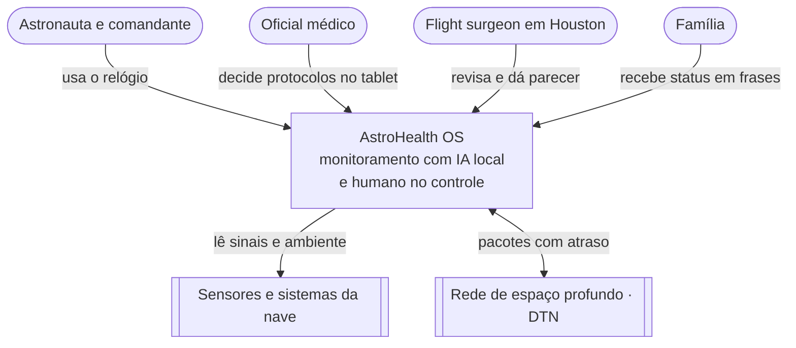

<a id="c4-nivel-2-containers"></a>

### Nível 2 · Containers

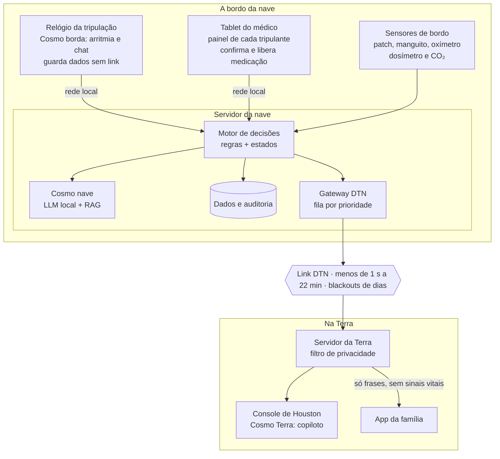

<a id="c4-nivel-3-componentes-do-servidor-da-nave"></a>

### Nível 3 · Componentes do servidor da nave

| Componente | Responsabilidade | Fala com |
| --- | --- | --- |
| Ingestão de sinais | Recebe leituras, marca fonte, hora e qualidade do sinal | Relógios, sensores, motor de decisões |
| Detectores | Modelos pequenos: arritmia, hipóxia, artefato de sensor, prontidão, humor e linha de base. O z robusto classifica cada sinal; o Isolation Forest, um modelo por tripulante, marca a combinação fora do padrão ([ADR-012](#adr-0012)). O calendário do ciclo avisa o trecho intenso a partir da ficha de solo ([ADR-013](#adr-0013)) | Ingestão, motor de decisões |
| Motor de decisões | Abre eventos, aplica o nível de autonomia, chama o humano responsável, escala por tempo | Detectores, apps, auditoria, gateway |
| Cosmo nave (LLM + RAG) | Conversa, explica evidências e resume; não muda estado | Motor de decisões (só leitura), apps |
| Base de protocolos | Protocolos médicos, manual do kit, estoque e validade de medicamentos | Cosmo nave, motor de decisões |
| Consentimentos | Quem autorizou o quê, para quem, até quando | Motor de decisões, gateway |
| Auditoria | Log só de inclusão com hash encadeado | Todos os componentes (escrita) |
| Gateway DTN | Monta pacotes, aplica prioridade e consentimento, guarda no blackout | Motor de decisões, link DTN |

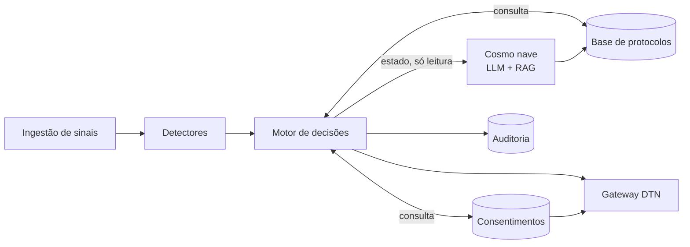

No relógio roda uma versão reduzida: ingestão, detector de arritmia e de artefato, chat básico e fila local. Assim, um alerta crítico não depende nem do servidor da nave.

<a id="comunicacao"></a>

## 04 · Implantação e comunicação

Dentro da nave, tudo conversa pela rede local em milissegundos. Para fora, os dados viajam em pacotes DTN, guardados e reenviados até chegar, sempre na ordem de prioridade.

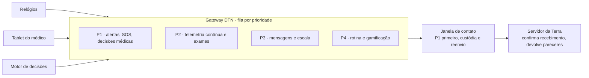

**Blackout:** a fila guarda tudo; P1 nunca é descartado; P4 pode virar um resumo. Cada pacote carrega a hora em que foi gerado ([ADR-006](#adr-0006)).

<a id="comunicacao-nos-de-implantacao"></a>

### Nós de implantação

| Nó | Onde roda | Comunicação |
| --- | --- | --- |
| Relógio | Pulso de cada tripulante | Rede local da nave (BLE ou Wi-Fi); guarda dados se o servidor cair |
| Tablet | Enfermaria, com o oficial médico | Wi-Fi da nave |
| Servidor da nave | Computador de bordo, com dois nós redundantes | Rede local para dentro; DTN para fora |
| Servidor da Terra | Data center em Houston | DTN para a nave; HTTPS para o console e o app |
| Console de Houston | Sala do flight surgeon | HTTPS, com autenticação forte |
| App da família | Celular da família | HTTPS, só o feed já filtrado |

<a id="comunicacao-perfis-de-missao"></a>

### Perfis de missão

O mesmo software se ajusta ao atraso. O perfil muda quem decide primeiro, não o código.

| Perfil | Atraso de ida | Link | Quem decide primeiro |
| --- | --- | --- | --- |
| ISS · órbita baixa | Menos de 1 s | Satélites TDRS | Houston junto com a tripulação |
| Gateway · órbita lunar | Cerca de 1,3 s | Deep Space Network | Tripulação, com Houston em segundos |
| Trânsito para Marte | 3 a 22 min, conforme a posição dos planetas | Deep Space Network | Tripulação; Houston revisa depois |
| Superfície de Marte | 3 a 22 min | Orbitador de relay + DSN | Tripulação; Houston revisa depois |

Referência: [NASA · Interplanetary Overlay Network (DTN)](https://www.nasa.gov/space-communications-navigation/interplanetary-overlay-network/).

<a id="decisoes"></a>

## 05 · Motor de decisões

Todo evento de saúde vira uma máquina de estados com um humano responsável. A IA só age sozinha em ações urgentes e reversíveis, e mesmo assim o humano pode desfazer.

<a id="decisoes-niveis-de-autonomia"></a>

### Níveis de autonomia

| Nível | O que a Cosmo faz | Exemplos na demo |
| --- | --- | --- |
| 0 · Observar | Registra e aprende o padrão de cada tripulante | Linha de base de FC, sono e HRV |
| 1 · Informar | Avisa, sem recomendar nada | Dose de radiação do dia, tendência de sono, combinação de sinais fora do padrão |
| 2 · Sugerir | Propõe; o humano decide | Beber água, respirar, treino mais leve no trecho do ciclo, prontidão para EVA |
| 3 · Preparar e pedir confirmação | Deixa tudo pronto e executa após um toque | Protocolo de emergência, abrigo, ultrassom guiado |
| 4 · Agir e avisar, com desfazer | Executa ações urgentes e reversíveis | Rota até o abrigo, modo noite, SOS na frente da fila |
| Nunca sozinha | Sempre exige um humano | Medicação, procedimentos invasivos, compartilhar saúde mental ou o ciclo, tirar alguém de tarefa crítica |

<a id="decisoes-linha-de-base-no-motor"></a>

### Linha de base no motor

O estado de três níveis sai do z robusto, sinal por sinal. O Isolation Forest não altera esse estado nem abre evento clínico. Ele vira sugestão de nível 1 só quando marca anomalia, o M2 classifica o sinal como bom e nenhum sinal está crítico sozinho. Se o M1 já abriu fibrilação atrial, ou se um sinal está crítico, permanece o evento aberto. A família não recebe escore nem faixa. O modelo está na [ADR-012](#adr-0012).

<a id="decisoes-calendario-do-ciclo-no-motor"></a>

### Calendário do ciclo no motor

A ficha de cada tripulante escolhe a direção. Com calendário, o relógio avisa só essa pessoa cerca de dois dias antes do trecho intenso. Sem calendário, a pergunta de cólica não abre e a Cosmo fica na linha de base pessoal. Na demo, Sarah e Elena têm calendário; Marcus e Kenji não têm. O da Elena não aparece no painel até ela autorizar. O relógio fala dos sintomas (cólica, inchaço ou humor), não do método. O método só entra quando a Cosmo precisa explicar: com supressão, o trecho não é ovulação; sem método, a janela segue a última menstruação. A pergunta só sai quando esse trecho coincide com sinais leves e o M2 classifica o sinal como bom. O cuidado é nível 2. O estado de três níveis não muda. Analgésico do kit fica com o oficial médico, em passo separado. Médico e Houston só veem com consentimento. A família não recebe fase, calendário, método nem sintoma. A decisão está na [ADR-013](#adr-0013).

<a id="decisoes-quem-decide-cada-tipo-de-evento"></a>

### Quem decide cada tipo de evento

Os prazos são metas de projeto, a validar com o time médico.

| Tipo de decisão | Humano responsável | Prazo para responder | Sem resposta, vai para |
| --- | --- | --- | --- |
| Leitura suspeita do sensor | O próprio astronauta | 20 s | Oficial médico |
| Protocolo clínico | Oficial médico | 60 s | Comandante e tripulante com treino médico |
| Medicação | Oficial médico | Sem escalonamento automático | Oficial médico substituto |
| Abrigo contra radiação | Comandante | 2 min | Próximo na cadeia de comando |
| Escala de tarefa crítica | Comandante | Até o início da tarefa | Próximo na cadeia de comando |
| Compartilhar saúde mental | O próprio astronauta | Não escala | Ninguém; exceção só em risco de vida |
| Compartilhar o ciclo | A própria astronauta | Não escala | Ninguém; a família não recebe |
| Ação de nível 4 | O próprio astronauta, por veto | 15 s para vetar | Aplica e oferece desfazer |

<a id="decisoes-estados-de-um-evento"></a>

### Estados de um evento

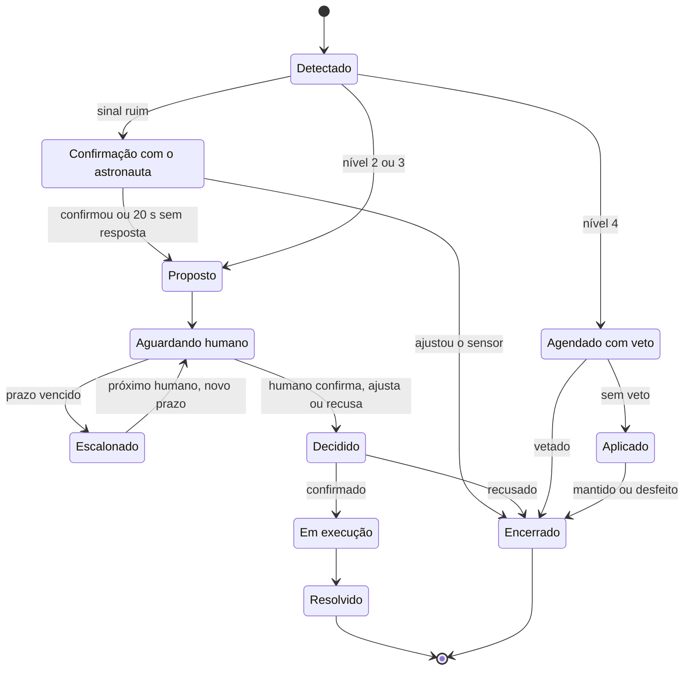

Cada transição grava na auditoria: evento, estado anterior e novo, quem decidiu, quando, versão do modelo e evidências usadas. O escalonamento sempre aponta para outro humano, nunca para a IA ([ADR-004](#adr-0004)).

<a id="fluxos"></a>

## 06 · Fluxos

Nos seis fluxos, a decisão acontece a bordo, e a Terra fica sabendo depois. Setas `--)` cruzam o link com a Terra e levam de menos de 1 s a 22 min, conforme o perfil de missão.

<a id="fluxos-emergencia-cardiaca"></a>

### Emergência cardíaca

Na demo: **Cenário → Emergência; depois confirme o protocolo no tablet** · [abrir a demo](https://claude.ai/artifact/CE5bxpHxaLhi8Af9SY7NmU)

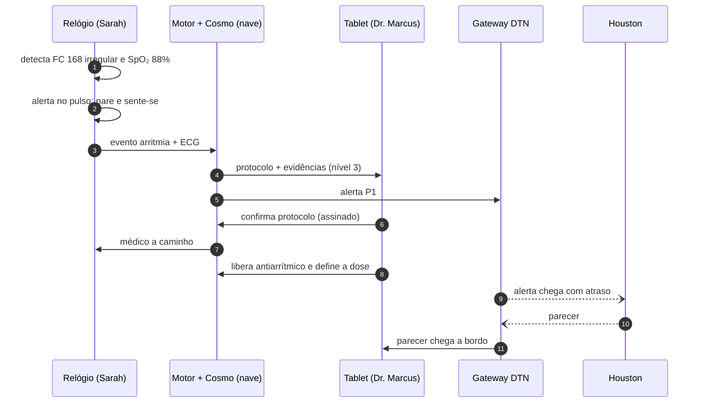

<a id="fluxos-tempestade-solar"></a>

### Tempestade solar

Na demo: **Injetar evento → Tempestade solar** · [abrir a demo](https://claude.ai/artifact/CE5bxpHxaLhi8Af9SY7NmU)

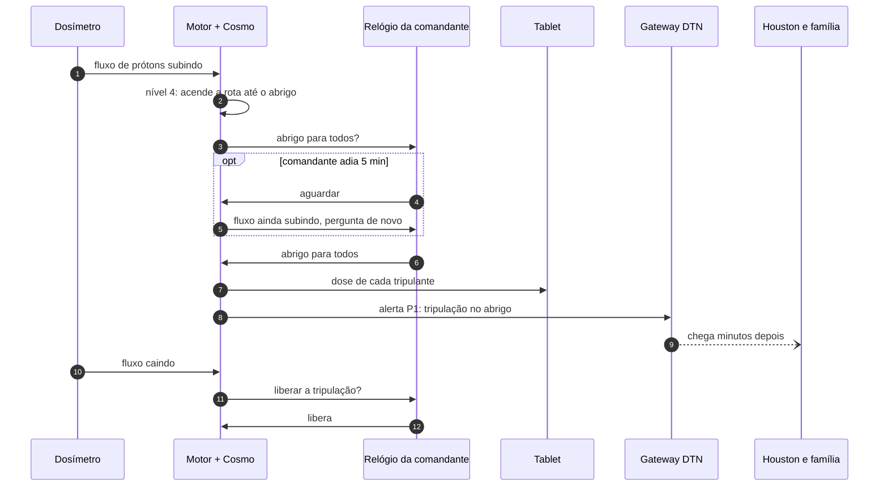

<a id="fluxos-sensor-solto"></a>

### Sensor solto

Na demo: **Injetar evento → Sensor solto** · [abrir a demo](https://claude.ai/artifact/CE5bxpHxaLhi8Af9SY7NmU)

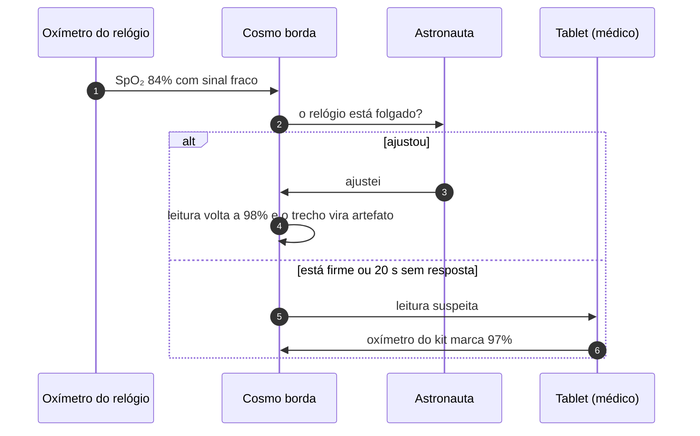

<a id="fluxos-saude-mental-com-consentimento"></a>

### Saúde mental com consentimento

Na demo: **Injetar evento → Queda de humor** · [abrir a demo](https://claude.ai/artifact/CE5bxpHxaLhi8Af9SY7NmU)

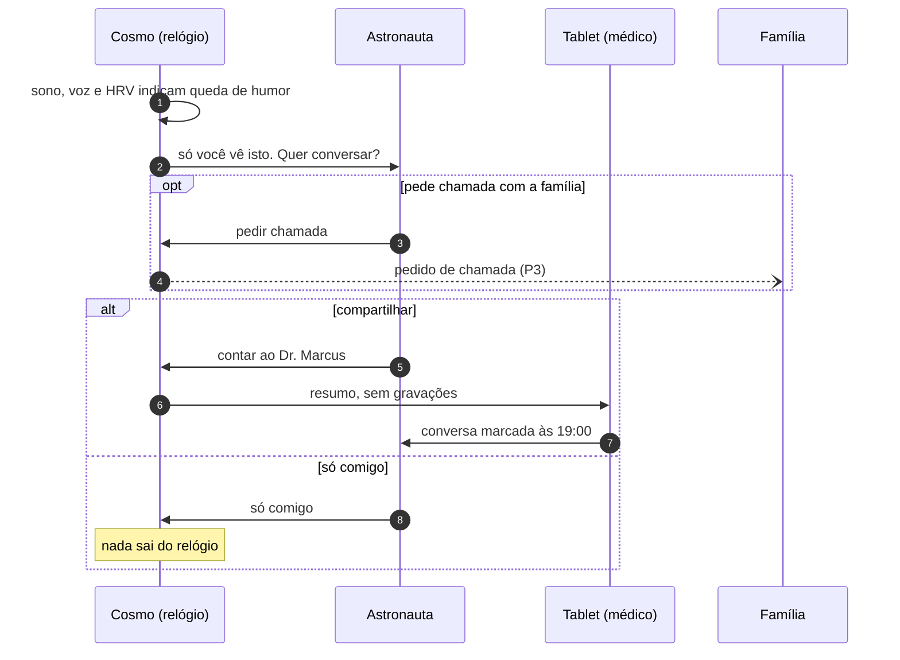

<a id="fluxos-calendario-do-ciclo"></a>

### Calendário do ciclo

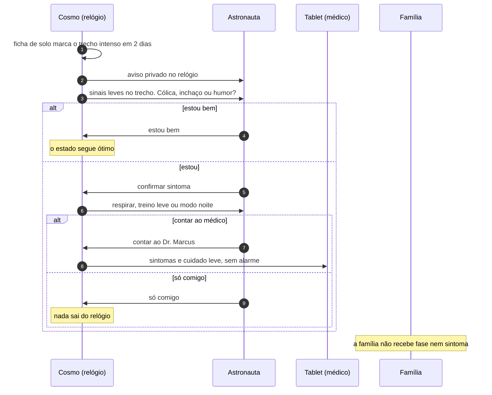

<a id="fluxos-blackout-e-volta-do-sinal"></a>

### Blackout e volta do sinal

Na demo: **Cenário → Blackout; depois Normal** · [abrir a demo](https://claude.ai/artifact/CE5bxpHxaLhi8Af9SY7NmU)

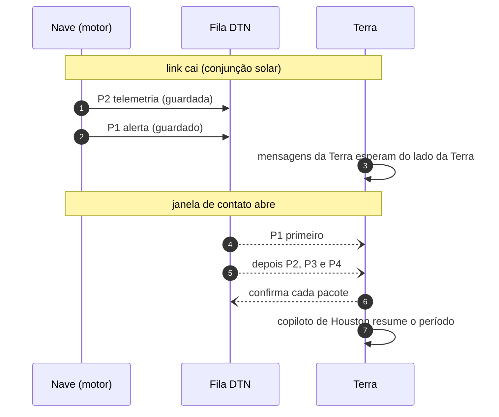

<a id="dados"></a>

## 07 · Modelo de dados

O centro do modelo é o Evento: leituras abrem eventos, a Cosmo anexa sugestões e só humanos registram decisões. Toda entidade carrega a hora em que foi gerada; a Terra acrescenta a hora em que recebeu.

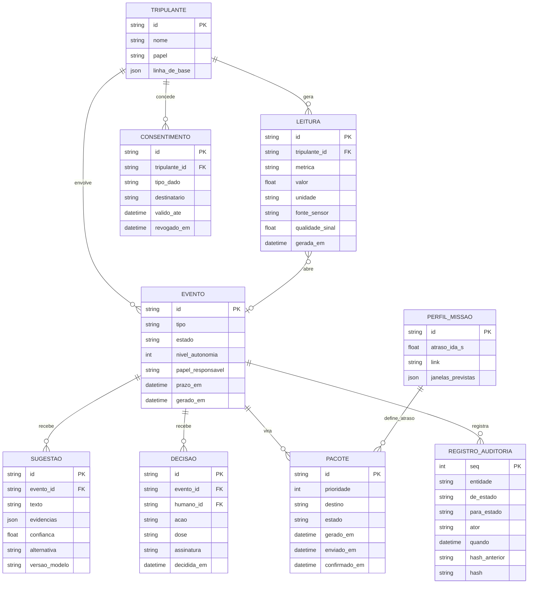

<a id="dados-ingestao-e-saida"></a>

### Ingestão e saída

A leitura entra pelo tópico MQTT. A ingestão grava fonte, hora e qualidade, e o `ia.py` devolve a análise. O z robusto pinta o estado no relógio e no painel. O motor escolhe o restante da saída. A Cosmo só lê esse estado e anexa a sugestão. O humano devolve a decisão assinada.

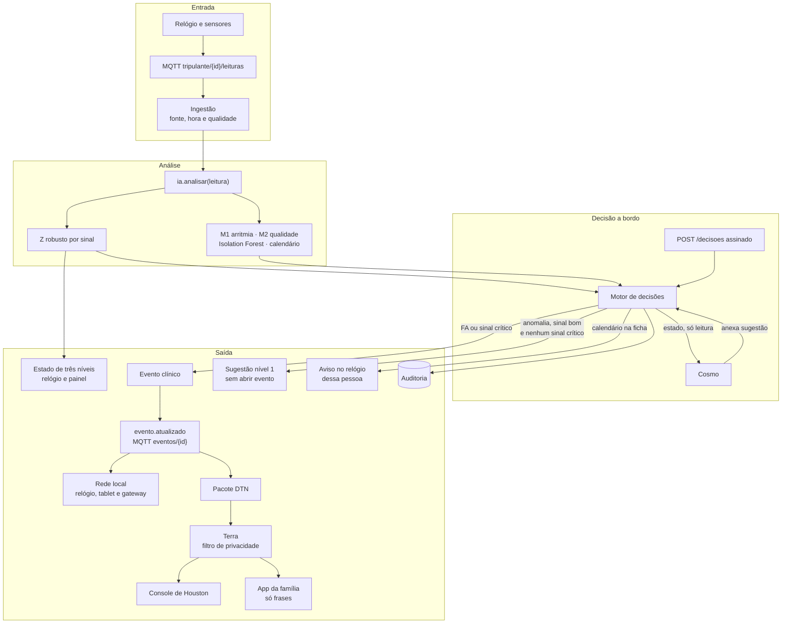

A sugestão de nível 1 sai quando o Isolation Forest marca anomalia, o M2 diz que o sinal é bom e nenhum sinal está crítico sozinho. Se o M1 já abriu fibrilação atrial, ou se um sinal está crítico, permanece o evento aberto, no contrato `evento.atualizado`. Com calendário na ficha, o aviso do trecho intenso fica no relógio dessa pessoa. A Terra recebe o pacote DTN e aplica o filtro: Houston vê o necessário para o parecer, e a família recebe frases prontas, sem escore, faixa ou ciclo. No relógio, com o servidor fora, seguem a ingestão, o detector de arritmia, o de artefato e a fila local.

<a id="dados-regras-de-escrita"></a>

### Regras de escrita

- **Sugestão:** escrita só pela Cosmo; nunca muda o estado do evento.
- **Decisão:** escrita só por humanos, sempre assinada.
- **Registro de auditoria:** só inclusão; cada registro guarda o hash do anterior.

<a id="dados-contrato-evento-atualizado"></a>

### Contrato `evento.atualizado`

O mesmo formato vai para o tablet pela rede local e para a Terra num pacote DTN. Schema em [contratos/evento-atualizado.schema.json](#contrato); exemplo em [contratos/exemplos/evento-arritmia.json](#contrato).

<a id="dados-analise-dos-modelos"></a>

### Análise dos modelos

O `ia.py` devolve M1, M2 e M3 no formato de [contratos/exemplos/analise-fa.json](#analise-fa). Os números desse arquivo são ilustrativos, até o treino do sábado. Em `m3.metricas`, cada sinal traz o z robusto e a faixa (`padrao`, `atencao`, `critico`). Em `m3.isolation_forest`, `score` é o `-score_samples` depois do `RobustScaler` daquela pessoa: quanto maior, mais a combinação se afasta do padrão dela. `evidencias` lista os sinais cuja troca pela mediana mais reduz esse escore. Quem decide se isso vira sugestão é o motor, pela [ADR-012](#adr-0012).

O calendário do ciclo sai no formato de [contratos/exemplos/analise-ciclo.json](#analise-ciclo). Os números também são ilustrativos. `ficha.calendario` diz se a Cosmo pode falar de ciclo. `ciclo.na_janela` e `ciclo.aviso_dias` vêm dessa ficha. `ciclo.perguntar` só fica verdadeiro quando a janela coincide com sinais leves e o M2 diz que o sinal é bom. `ciclo.compartilhado` começa falso: médico e Houston só entram depois do consentimento. A família não está nesse contrato.

Quem não tem calendário sai no formato de [contratos/exemplos/analise-kenji.json](#analise-kenji). `ciclo` fica nulo e a sugestão usa a linha de base pessoal. A regra dos dois caminhos está na [ADR-013](#adr-0013).

<a id="dados-interfaces-do-prototipo"></a>

### Interfaces do protótipo

| Interface | Tipo | Quem publica ou chama | Quem consome |
| --- | --- | --- | --- |
| `tripulante/{id}/leituras` | Tópico MQTT | Relógio, sensores | Ingestão, detectores |
| `eventos/{id}` | Tópico MQTT | Motor de decisões | Relógio, tablet, gateway |
| `POST /decisoes` | REST (FastAPI) | Relógio, tablet (assinado) | Motor de decisões |
| `POST /consentimentos` | REST | Relógio | Motor, gateway |
| `POST /cosmo/chat` | REST | Relógio, tablet, console | Cosmo (nave ou Terra) |
| `GET /familia/feed` | REST, só na Terra | App da família | Filtro de privacidade |

<a id="contrato"></a>

### Exemplo de mensagem `evento.atualizado`

```json
{
  "tipo_msg": "evento.atualizado",
  "versao_contrato": "1.0",
  "evento": {
    "id": "evt-0042",
    "tipo": "arritmia",
    "tripulante_id": "sarah",
    "estado": "aguardando_humano",
    "nivel_autonomia": 3,
    "responsavel_papel": "oficial_medico",
    "prazo_em": "2026-11-14T09:43:12Z",
    "gerado_em": "2026-11-14T09:42:12Z"
  },
  "sugestao": {
    "texto": "Repouso, O2 a 2 L/min e ECG de 12 derivações",
    "confianca": 0.87,
    "alternativa": "taquicardia sinusal por esforço",
    "evidencias": [
      "rr_irregular_30s",
      "fc_acima_150",
      "spo2_abaixo_90_40s"
    ],
    "versao_modelo": "arritmia-borda-0.3"
  },
  "pacote": {
    "prioridade": 1,
    "destinos": [
      "oficial_medico",
      "houston"
    ]
  }
}
```

<a id="analise-fa"></a>

### Exemplo de análise com z robusto e Isolation Forest

```json
{
  "tripulante_id": "sarah",
  "m1": {
    "classe": "fa",
    "confianca": 0.87,
    "atributos": ["rr_irregular_30s", "fc_media", "sdnn"],
    "versao_modelo": "arritmia-borda-0.3"
  },
  "m2": {
    "qualidade": "bom",
    "confianca": 0.94,
    "versao_modelo": "qualidade-0.2"
  },
  "m3": {
    "estado": "critico",
    "versao_z": "m3-z-0.1",
    "metricas": {
      "fc": {"z": 6.2, "faixa": "critico"},
      "spo2": {"z": -4.1, "faixa": "critico"},
      "hrv": {"z": -3.4, "faixa": "critico"},
      "temperatura": {"z": 1.1, "faixa": "atencao"},
      "sono": {"z": 0.2, "faixa": "padrao"},
      "hidratacao": {"z": -0.8, "faixa": "padrao"}
    },
    "isolation_forest": {
      "anomalo": true,
      "score": 0.71,
      "limiar": 0.62,
      "evidencias": ["fc", "spo2"],
      "versao_modelo": "m3-if-0.1"
    }
  }
}
```

<a id="analise-ciclo"></a>

### Exemplo de análise do calendário do ciclo

```json
{
  "tripulante_id": "sarah",
  "ficha": {
    "sexo": "feminino",
    "calendario": true,
    "metodo": "pilula_combinada_continua",
    "ultima_menstruacao": "2026-06-02",
    "duracao_tipica_dias": 28,
    "trecho_intenso": "segunda_quinzena",
    "versao_ficha": "pre-voo-0.1"
  },
  "m2": {
    "qualidade": "bom",
    "confianca": 0.94,
    "versao_modelo": "qualidade-0.2"
  },
  "m3": {
    "estado": "otimo",
    "versao_z": "m3-z-0.1",
    "metricas": {
      "fc": {"z": 0.6, "faixa": "padrao"},
      "temperatura": {"z": 0.4, "faixa": "padrao"},
      "hrv": {"z": -0.7, "faixa": "padrao"},
      "sono": {"z": -0.9, "faixa": "padrao"}
    }
  },
  "ciclo": {
    "na_janela": true,
    "aviso_dias": 2,
    "sinais_leves": ["fc", "temperatura", "sono"],
    "perguntar": true,
    "sugestoes": ["respirar", "treino_leve"],
    "compartilhado": false,
    "versao": "ciclo-calendario-0.1"
  }
}
```

<a id="analise-kenji"></a>

### Exemplo sem calendário de ciclo

```json
{
  "tripulante_id": "kenji",
  "ficha": {
    "sexo": "masculino",
    "calendario": false,
    "versao_ficha": "pre-voo-0.1"
  },
  "m2": {
    "qualidade": "bom",
    "confianca": 0.91,
    "versao_modelo": "qualidade-0.2"
  },
  "m3": {
    "estado": "otimo",
    "versao_z": "m3-z-0.1",
    "metricas": {
      "fc": {"z": 0.2, "faixa": "padrao"},
      "sono": {"z": 0.1, "faixa": "padrao"},
      "hrv": {"z": 0.4, "faixa": "padrao"}
    }
  },
  "ciclo": null,
  "sugestao": {
    "nivel": 2,
    "texto": "Manter o treino resistivo. A ficha não tem calendário de ciclo.",
    "versao": "linha-de-base-0.1"
  }
}
```

<a id="lakehouse"></a>

## Dados até o lakehouse

A NASA não publica o prontuário da tripulação. O treino não espera esse arquivo. O lakehouse fica na Terra. A nave guarda o operacional e manda, em P2, o agregado de 1 minuto, a janela crua de ECG quando um evento abre, o resumo da noite e a ficha. O relógio, o patch, o kit, o registro de água e a cabine publicam o mesmo contrato, com `dispositivo_id` e `canal`. CO₂ não tem tripulante. Estresse é canal derivado, na zona prata. A ficha não é série temporal.

O bronze guarda o cru. A prata alinha o relógio, unifica a unidade e marca a qualidade do M2. O ouro é uma tabela por modelo: CinC 2017 para M1 e M2, vitais sintéticos para o M3, ficha sem treino para o calendário. O job grava o `.joblib`. Esse artefato sobe para a nave. O lakehouse não sobe. O texto completo está em `4-arquitetura/docs/11-dados-lakehouse.md`.

<a id="stack"></a>

## 08 · Stack híbrida

Os diagramas descrevem o sistema como ele seria numa nave real. O protótipo do hackathon implementa as mesmas fronteiras com a stack que o time já domina. Regra para as duas colunas: o LLM conversa, explica e resume, mas quem decide o estado de um evento é o motor de decisões determinístico.

| Camada | Referência para produção (padrão NASA) | Protótipo do hackathon |
| --- | --- | --- |
| Relógio (borda) | Wear OS, watchOS ou firmware dedicado; modelos pequenos quantizados (TFLite/LiteRT, ONNX) para arritmia e qualidade de sinal | Relógio simulado na demo web; modelos em Python com ONNX Runtime ou scikit-learn |
| Rede local da nave | Wi-Fi e BLE da nave; mensageria com QoS e autenticação mútua | MQTT (Mosquitto) ou WebSocket local |
| Cosmo nave | LLM local quantizado + RAG sobre protocolos médicos e manual do kit, sem internet | Python + FastAPI; LangChain ou CrewAI; ChromaDB com os protocolos; LLM local via Ollama |
| Motor de decisões | Regras + máquina de estados determinística, certificável e testável | Python com máquina de estados (biblioteca transitions ou própria) |
| Armazenamento | Banco embarcado + log de auditoria só de inclusão, com hash encadeado | SQLite + tabela de eventos só de inclusão |
| Link nave ⇄ Terra | DTN com Bundle Protocol (por exemplo, o ION da NASA), custódia e prioridade | Simulador de atraso em Python: fila por prioridade e atraso configurável por perfil de missão |
| Cosmo Terra (Houston) | Modelos maiores, inclusive em nuvem, sob regras para dados de saúde | FastAPI + LangChain; API da OpenAI permitida só aqui, nunca a bordo |
| App da família | App móvel; filtro de privacidade aplicado no servidor da Terra | Página web responsiva, como na demo |
| Testes | Testes de cenário e de tempo real | Robot Framework para aceitação dos fluxos + pytest nas regras |

**Por que híbrida:** a banca vê uma arquitetura plausível para uma nave real, e o time entrega código funcionando em 48 h. Trocar o simulador pelo ION ou o relógio simulado por um real não muda as fronteiras entre os componentes ([ADR-011](#adr-0011)).

<a id="stack-linha-de-base-no-prototipo-m3"></a>

### Linha de base no protótipo (M3)

O M3 roda no `ia.py`, no servidor da nave, com scikit-learn. O relógio recebe o estado de três níveis; a floresta não roda no pulso.

- **Z robusto:** mediana e MAD de cada tripulante, por sinal. Isso pinta o avatar e cada indicador do painel.
- **Isolation Forest (`m3-if-0.1`):** um modelo por tripulante, treinado só nos minutos normais de `dados/vitais.csv`. O pipeline leva um `RobustScaler` daquela pessoa e depois a floresta. O limiar cabe em no máximo 1 alarme por pessoa por dia simulado. A explicação troca cada sinal pela mediana e fica com os que mais reduzem o escore.

As duas peças saem juntas em `analisar(leitura)`. O escore não substitui a faixa de cada sinal. A regra de quando o motor abre sugestão de nível 1 está na [ADR-012](#adr-0012). O exemplo de resposta, no quadro de fibrilação atrial da Sarah, está em [contratos/exemplos/analise-fa.json](#analise-fa).

O calendário do ciclo também sai de `analisar(leitura)`, ao lado do M3, só quando `ficha.calendario` é verdadeiro. Sem calendário, `ciclo` fica nulo e a sugestão usa a linha de base pessoal, como em [contratos/exemplos/analise-kenji.json](#analise-kenji). A previsão, quando existe, conta os dias da ficha de solo e, se a pessoa não está em supressão, ajusta a janela quando a frequência e a temperatura da pele sobem no padrão dela. Não é um classificador de fase. O exemplo com calendário está em [contratos/exemplos/analise-ciclo.json](#analise-ciclo), e a regra na [ADR-013](#adr-0013).

<a id="stack-pipeline-de-dados-e-algoritmos"></a>

### Pipeline de dados e algoritmos

O treino fica em lote e grava artefatos. Cada leitura do simulador, uma por segundo, só passa por `ia.analisar(leitura)`. O motor, o hash e a fila não aprendem. O M2 ainda não tem o estimador escolhido: o plano fixa o dado, o rótulo e o recall.

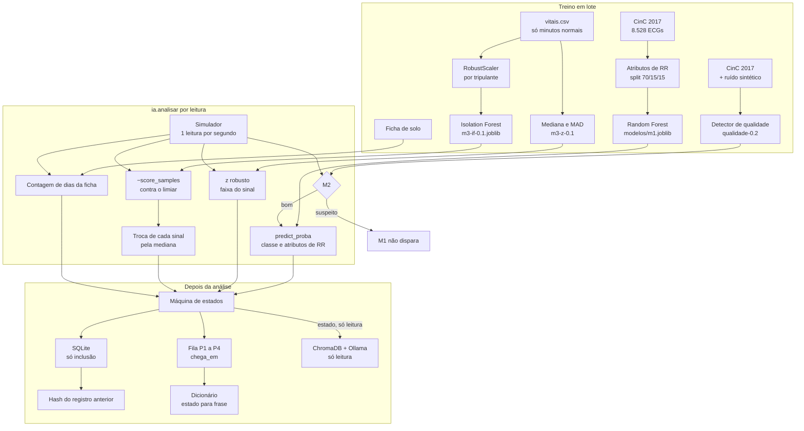

| Peça | Algoritmo | Entrada | Saída |
| --- | --- | --- | --- |
| M1 `arritmia-borda-0.3` | Random Forest sobre atributos de RR. Guarda a probabilidade e os 3 atributos que mais pesaram | CinC 2017, split 70/15/15. Meta: F1 da classe FA ≥ 0,75 | `classe`, `confianca`, atributos de RR em `modelos/m1.joblib` |
| M2 `qualidade-0.2` | Detector de qualidade. O estimador ainda não está escolhido | CinC 2017 com ruído sintético. Meta: recall de `suspeito` ≥ 0,9 | `bom` ou `suspeito`. Com sinal suspeito, o M1 não dispara |
| M3 z `m3-z-0.1` | Mediana e MAD de cada tripulante, por sinal | Minutos dos vitais sintéticos | Faixa `padrao`, `atencao` ou `critico`. A soma vira o estado de três níveis |
| M3 floresta `m3-if-0.1` | `RobustScaler` da pessoa e, em seguida, Isolation Forest. Um modelo por tripulante | Só os minutos normais de `dados/vitais.csv`. Cenários de FA e de relógio folgado ficam fora | `−score_samples`. O limiar, na validação, cabe em no máximo 1 alarme por pessoa por dia simulado |
| Evidência da floresta | Troca cada sinal pela mediana da pessoa e mede a queda do escore | Vetor já escalado daquela leitura | `evidencias`: os sinais que mais reduzem o escore |
| Ciclo `ciclo-calendario-0.1` | Contagem de dias da ficha. Sem supressão, a janela se ajusta quando FC e temperatura da pele sobem no padrão dela | Ficha de solo. Não é classificador de fase | `na_janela`, `aviso_dias`. Sem calendário, `ciclo` fica nulo |
| Motor | Máquina de estados determinística, biblioteca `transitions` ou dicionário próprio | JSON do `ia.analisar` e as regras da [ADR-012](#adr-0012) e da [ADR-013](#adr-0013) | Estado do evento. A Cosmo não escreve nesse estado |
| Cosmo | Busca no ChromaDB e geração no Ollama, pela LangChain ou CrewAI | Protocolos indexados e o estado, só para leitura | Texto com a fonte citada. Nenhuma rota que muda estado |
| Auditoria | Hash do registro anterior, só inclusão | Transição, sugestão, decisão e escalonamento | Trilha no SQLite, copiada para a Terra em P2 |
| Link | Fila por prioridade. `chega_em = agora + atraso` do perfil de missão | `evento.atualizado` | P1 a P4. O feed da família sai de um dicionário de estado para frase |

<a id="stack-estrutura-sugerida-do-codigo-do-prototipo"></a>

### Estrutura sugerida do código do protótipo

```text
astrohealth/
├── nave/
│   ├── ingestao/          # leituras + qualidade de sinal
│   ├── detectores/        # arritmia, artefato, linha de base (z e Isolation Forest), calendário do ciclo, prontidão, humor
│   ├── motor/             # máquina de estados + regras + prazos
│   ├── cosmo/             # LangChain/CrewAI + ChromaDB + Ollama
│   ├── auditoria/         # log com hash encadeado (SQLite)
│   └── gateway_dtn/       # fila por prioridade + simulador de atraso
├── terra/
│   ├── servidor/          # recepção, confirmação, filtro de privacidade
│   └── cosmo_terra/       # copiloto de Houston
├── apps/                  # relógio, tablet, console, família (web)
├── contratos/             # JSON Schemas compartilhados
└── testes/
    ├── aceitacao/         # Robot Framework, um .robot por fluxo
    └── unidade/           # pytest
```

<a id="seguranca"></a>

## 09 · Segurança e privacidade

Os maiores riscos são um comando médico falso entrando na rede da nave e dados clínicos chegando a quem não deveria. As ameaças seguem o modelo STRIDE, mais duas específicas de IA.

| Ameaça | Exemplo no AstroHealth | Mitigação |
| --- | --- | --- |
| Falsificação de identidade | Um nó falso injeta leituras ou confirma um protocolo | Chave por dispositivo, autenticação mútua e decisões médicas assinadas |
| Adulteração | Alguém altera a trilha de auditoria depois de um erro | Log só de inclusão com hash encadeado, copiado para a Terra |
| Repúdio | "Não fui eu que liberei a medicação" | Cada decisão leva a identidade do humano (biometria do tablet + PIN) |
| Vazamento de informação | A família ou terceiros veem dados clínicos | Filtro de privacidade no servidor da Terra, cifragem e consentimento para saúde mental e para o ciclo |
| Negação de serviço | Telemetria de rotina satura o link na janela de contato | Fila por prioridade, cota por classe e banda reservada para prioridade 1 |
| Elevação de privilégio | O app da família tenta acessar a API clínica | Papéis por ator; a família só lê o feed já filtrado |
| Injeção de instruções na IA | Uma mensagem externa tenta fazer o LLM "aprovar" algo | O LLM não tem permissão de ação; tudo passa pelo motor de decisões; texto externo é tratado como dado |
| Deriva do modelo | Um modelo novo começa a errar arritmias | Modo sombra e aprovação do oficial médico antes de entrar em uso |

<a id="seguranca-regras-de-privacidade"></a>

### Regras de privacidade

- **Consentimento granular e revogável:** por tipo de dado (sinais vitais, saúde mental, ciclo, localização) e por destinatário (oficial médico, Houston, família).
- **Exceção única:** risco de vida vai ao médico sem consentimento, e isso fica registrado na auditoria.
- **Minimização:** a família recebe frases prontas, nunca números; Houston recebe o necessário para o parecer.
- **Dado de saúde é dado sensível:** tratar com o rigor da LGPD (art. 11) no Brasil, usando a HIPAA como referência de mercado nos EUA.

<a id="seguranca-matriz-de-acesso"></a>

### Matriz de acesso

| Dado | Astronauta | Oficial médico | Comandante | Houston | Família |
| --- | --- | --- | --- | --- | --- |
| Sinais vitais próprios | Sim | Sim | Só estado (ótimo/atenção/crítico) | Sim, com atraso | Não |
| ECG bruto | Sim | Sim | Não | Sim, com atraso | Não |
| Alerta de saúde mental | Sim | Só com consentimento | Não | Só com consentimento | Não |
| Calendário e sintomas do ciclo | Sim | Só com consentimento | Não | Só com consentimento | Não |
| Dose de radiação | Sim | Sim | Sim | Sim | Não |
| Status em frases | Sim | Sim | Sim | Sim | Sim |
| Trilha de auditoria | Própria | Sim | Sim | Sim | Não |

<a id="roadmap"></a>

## 10 · Roadmap e riscos

O MVP precisa dos 16 requisitos essenciais funcionando até o fechamento das submissões, em 15/11 às 23:59. A versão acadêmica, para a pós, fica para a semana seguinte.

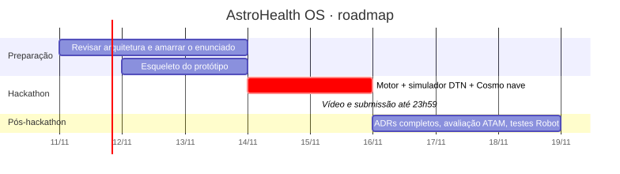

O que a demo atual já mostra não precisa ser reimplementado no hackathon. O código novo são o motor de decisões, o simulador DTN e a Cosmo nave com RAG.

<a id="roadmap-riscos"></a>

### Riscos

| Risco | Efeito | Mitigação |
| --- | --- | --- |
| O enunciado cobra algo fora deste escopo | Retrabalho no meio do evento | Colar o enunciado e os critérios antes de 13/11 e cruzar com os requisitos |
| LLM local lento no notebook do evento | A demo trava na frente da banca | Modelo pequeno e quantizado; respostas prontas como alternativa |
| Escopo grande para 48 h | MVP incompleto | Só os 16 requisitos essenciais; o resto fica na demo atual |
| Conselho médico errado ou exagerado | Perda de credibilidade | Protocolos de fontes públicas, aviso de que não é dispositivo médico, humano sempre decide |
| Integração MQTT e web atrasa | Fluxos não fecham ponta a ponta | WebSocket direto como plano B |

<a id="roadmap-proximos-passos"></a>

### Próximos passos

- [ ] Colar o enunciado oficial e os critérios de avaliação em `docs/01-visao-geral.md`
- [ ] Dividir o time por container: motor, Cosmo nave, simulador DTN, front
- [ ] Criar o repositório a partir desta pasta
- [ ] Escrever os testes de aceitação dos fluxos de emergência e de sensor solto
- [ ] Montar a base de protocolos médicos para o RAG

<a id="roadmap-fontes"></a>

### Fontes

- [NASA Human Research Program: os cinco perigos (RIDGE)](https://www.nasa.gov/hrp/hazards)
- [NASA Space Apps Challenge 2026](https://www.spaceappschallenge.org/2026/)
- [Desafio: Create Health Monitoring Software for Astronauts…](https://www.spaceappschallenge.org/2026/challenges/health-monitoring-software/)
- [NASA: Interplanetary Overlay Network (DTN)](https://www.nasa.gov/space-communications-navigation/interplanetary-overlay-network/)

<a id="adrs"></a>

## 11 · Decisões de arquitetura

Decisões no formato MADR, todas aceitas. Abra cada uma para ver contexto, alternativas e consequências.

<a id="adr-0001"></a>

### ADR-001: IA na borda primeiro; a Terra só apoia

- **Status:** aceita
- **Data:** 2026-11-11
- **Relacionadas:** [ADR-005](#adr-0005), [ADR-010](#adr-0010)

#### Contexto

A caminho de Marte, cada mensagem leva de 3 a 22 min por trecho, e conjunções solares cortam o contato por dias. Uma arritmia ou uma tempestade solar exigem resposta em segundos.

#### Decisão

Toda detecção e toda decisão que protege a vida rodam a bordo: o relógio detecta e alerta sozinho; o servidor da nave abre o evento e chama o humano responsável. A Terra recebe, revisa e devolve pareceres.

#### Alternativas consideradas

- **Processar tudo na Terra:** Simples e com modelos maiores, mas inútil com minutos de atraso e blackouts.
- **Processar tudo no servidor da nave:** Bom para modelos médios, mas o relógio ficaria sem alerta se o servidor ou a rede local caíssem.

#### Consequências

**Positivas**

- Alerta crítico em menos de 1 s, mesmo sem rede local.
- A tripulação continua protegida durante blackouts.

**Negativas**

- Modelos a bordo são menores e precisam de validação cuidadosa.
- Mais software para manter em vários nós.

<a id="adr-0002"></a>

### ADR-002: Motor de decisões determinístico separado do LLM

- **Status:** aceita
- **Data:** 2026-11-11
- **Relacionadas:** [ADR-003](#adr-0003), [ADR-004](#adr-0004), [ADR-008](#adr-0008)

#### Contexto

LLMs são ótimos para conversar, explicar e resumir, mas podem alucinar e são difíceis de certificar. Uma decisão clínica precisa ser previsível, testável e auditável.

#### Decisão

Só o motor de decisões (regras + máquina de estados) muda o estado de um evento. A Cosmo (LLM + RAG) lê o estado, explica evidências e conversa, mas não tem permissão de ação. Toda saída do LLM que sugira ação vira uma Sugestão, nunca uma Decisão.

#### Alternativas consideradas

- **Agente de LLM decidindo (CrewAI/LangChain com ferramentas de ação):** Flexível, mas imprevisível, difícil de testar e vulnerável a injeção de instruções.
- **Sem LLM:** Mais simples, mas perde a conversa, a explicabilidade e os resumos para Houston.

#### Consequências

**Positivas**

- Comportamento previsível e testável com Robot Framework e pytest.
- Injeção de instruções no LLM não consegue aprovar nada.

**Negativas**

- Regras precisam ser escritas e mantidas à mão.
- Duas peças para integrar: motor e Cosmo.

<a id="adr-0003"></a>

### ADR-003: Níveis de autonomia de 0 a 4 e a lista do que a IA nunca faz sozinha

- **Status:** aceita
- **Data:** 2026-11-11
- **Relacionadas:** [ADR-002](#adr-0002), [ADR-004](#adr-0004)

#### Contexto

Ações diferentes têm risco e reversibilidade diferentes: acender a rota até o abrigo não se compara a liberar um medicamento.

#### Decisão

Cada tipo de evento tem um nível: 0 observar, 1 informar, 2 sugerir, 3 preparar e pedir confirmação, 4 agir e avisar com desfazer (só ações urgentes e reversíveis). Medicação, procedimentos invasivos, compartilhar saúde mental e tirar alguém de tarefa crítica nunca acontecem sem um humano.

#### Alternativas consideradas

- **Autonomia ligada ou desligada:** Simples de explicar, mas força o mesmo tratamento para riscos muito diferentes.
- **Autonomia decidida caso a caso pelo LLM:** Imprevisível e impossível de auditar.

#### Consequências

**Positivas**

- Política de autonomia explícita e revisável pelo time médico.
- A banca vê com clareza onde a IA para.

**Negativas**

- Cada novo evento precisa ser classificado antes de entrar em produção.

<a id="adr-0004"></a>

### ADR-004: Um humano responsável por tipo de decisão; sem resposta, escala para outro humano

- **Status:** aceita
- **Data:** 2026-11-11
- **Relacionadas:** [ADR-003](#adr-0003), [ADR-008](#adr-0008)

#### Contexto

Sob pressão de tempo, é tentador deixar a IA decidir quando ninguém responde. Isso tiraria a responsabilidade humana justo nos momentos mais críticos.

#### Decisão

Cada tipo de decisão tem um papel responsável (astronauta, oficial médico, comandante) e um prazo. Prazo vencido escala para o próximo humano da cadeia, nunca para a IA. Exceção: ações de nível 4, que já são reversíveis.

#### Alternativas consideradas

- **A IA assume depois do prazo:** Rápido, mas transfere decisões clínicas para a máquina.
- **Esperar indefinidamente pelo responsável:** Mantém a responsabilidade, mas pode custar vidas.

#### Consequências

**Positivas**

- Responsabilidade humana preservada e registrada.
- Tempo de resposta limitado pela cadeia de escalonamento.

**Negativas**

- Exige definir a cadeia de substitutos de cada papel.

<a id="adr-0005"></a>

### ADR-005: DTN com Bundle Protocol e fila por prioridade

- **Status:** aceita
- **Data:** 2026-11-11
- **Relacionadas:** [ADR-006](#adr-0006), [ADR-011](#adr-0011)

#### Contexto

Protocolos comuns da internet assumem conexão contínua e atrasos de milissegundos. Entre a nave e a Terra há minutos de atraso e quedas de dias.

#### Decisão

A comunicação nave ⇄ Terra usa DTN (Bundle Protocol), com custódia, reenvio e quatro classes de prioridade: P1 alertas, SOS e decisões médicas; P2 telemetria e exames; P3 mensagens e escala; P4 rotina e gamificação. P1 tem banda reservada e nunca é descartado.

#### Alternativas consideradas

- **TCP/IP direto:** Quebra com atrasos longos e quedas.
- **MQTT ponta a ponta:** Ótimo na rede local, mas não foi feito para minutos de atraso e blackouts.

#### Consequências

**Positivas**

- Nada se perde no blackout; alertas chegam primeiro.
- Alinhado ao que a NASA já usa (ION).

**Negativas**

- No hackathon, o DTN é simulado em Python.

<a id="adr-0006"></a>

### ADR-006: A Terra vê snapshots atrasados, com a hora de origem

- **Status:** aceita
- **Data:** 2026-11-11
- **Relacionadas:** [ADR-005](#adr-0005)

#### Contexto

Mostrar dados de 12 minutos atrás como se fossem ao vivo leva Houston a decidir sobre uma situação que já mudou.

#### Decisão

Toda informação carrega a hora em que foi gerada e a hora em que chegou. O console mostra "você está vendo o passado" e o atraso do perfil de missão. Pareceres de Houston são revisões, não comandos.

#### Alternativas consideradas

- **Esconder o atraso:** Interface mais limpa, mas engana quem decide.

#### Consequências

**Positivas**

- Houston decide sabendo de quando é o dado.

**Negativas**

- Interfaces mostram dois relógios, o de geração e o de recebimento.

<a id="adr-0007"></a>

### ADR-007: Consentimento granular para saúde mental; exceção só em risco de vida

- **Status:** aceita
- **Data:** 2026-11-11
- **Relacionadas:** [ADR-002](#adr-0002)

#### Contexto

Se o astronauta achar que tudo o que sente vai para o médico e para a Terra, ele esconde sintomas, e o sistema perde valor justamente no isolamento.

#### Decisão

Alertas de bem-estar ficam só com o astronauta até ele autorizar. O consentimento é por tipo de dado e por destinatário, e pode ser revogado. Sem consentimento, nada sai do relógio. A única exceção é risco de vida, que vai ao médico e fica registrado na auditoria.

#### Alternativas consideradas

- **O médico vê tudo:** Mais informação clínica, menos confiança da tripulação.
- **Nada é monitorado:** Privacidade total, mas o risco de isolamento fica sem resposta.

#### Consequências

**Positivas**

- Confiança da tripulação no sistema.
- Alinhado à LGPD (dado sensível).

**Negativas**

- O médico pode não saber de algo que ele gostaria de saber.

<a id="adr-0008"></a>

### ADR-008: Trilha de auditoria só de inclusão, com hash encadeado

- **Status:** aceita
- **Data:** 2026-11-11
- **Relacionadas:** [ADR-004](#adr-0004)

#### Contexto

Depois de um evento, é preciso saber o que a IA sugeriu, quem decidiu e quando, e provar que nada foi alterado.

#### Decisão

Cada transição de estado, sugestão, decisão e escalonamento gera um registro só de inclusão, com o hash do registro anterior. A trilha é copiada para a Terra em P2.

#### Alternativas consideradas

- **Logs comuns da aplicação:** Fáceis, mas editáveis e incompletos.

#### Consequências

**Positivas**

- Revisão confiável de decisões; base para pareceres e para a pesquisa.

**Negativas**

- Mais armazenamento e mais tráfego de baixa prioridade.

<a id="adr-0009"></a>

### ADR-009: Com sinal ruim, perguntar ao astronauta antes de alarmar

- **Status:** aceita
- **Data:** 2026-11-11
- **Relacionadas:** [ADR-004](#adr-0004)

#### Contexto

Sensores de pulso erram quando o relógio está folgado. Alarmes falsos cansam a equipe médica, e alarmes descartados em silêncio escondem eventos reais.

#### Decisão

Quando a qualidade do sinal é baixa, a Cosmo pergunta ao astronauta se o relógio está folgado. Se ele ajusta e a leitura volta, o trecho vira artefato. Se ele confirma, ou não responde em 20 s, o caso vai ao oficial médico.

#### Alternativas consideradas

- **Alarmar sempre:** Seguro no papel, mas gera fadiga de alarme.
- **Descartar leituras ruins em silêncio:** Sem ruído, mas pode esconder um evento real.

#### Consequências

**Positivas**

- Menos alarmes falsos sem esconder eventos reais.

**Negativas**

- Exige um bom estimador de qualidade de sinal.

<a id="adr-0010"></a>

### ADR-010: Modelos novos entram em modo sombra e exigem aprovação médica

- **Status:** aceita
- **Data:** 2026-11-11
- **Relacionadas:** [ADR-001](#adr-0001), [ADR-008](#adr-0008)

#### Contexto

A Terra pode treinar modelos melhores durante a missão, mas um modelo novo pode piorar justamente em casos raros.

#### Decisão

Um modelo novo roda em paralelo, sem agir, comparando suas previsões com as do modelo atual. Só entra em uso depois que o oficial médico aprova, e a versão fica registrada em cada sugestão.

#### Alternativas consideradas

- **Atualização automática vinda da Terra:** Rápida, mas arrisca trocar um modelo bom por um pior no meio da missão.

#### Consequências

**Positivas**

- Atualizações seguras e rastreáveis.

**Negativas**

- Atualizações demoram mais para valer.

<a id="adr-0011"></a>

### ADR-011: Stack híbrida: padrão NASA nos diagramas, stack do time no protótipo

- **Status:** aceita
- **Data:** 2026-11-11
- **Relacionadas:** [ADR-005](#adr-0005)

#### Contexto

O hackathon dura 48 h. Implementar ION, firmware de relógio e modelos certificados não cabe nesse prazo, mas a banca espera uma arquitetura plausível.

#### Decisão

Os diagramas descrevem a referência para produção (DTN/ION, modelos embarcados, LLM local). O protótipo implementa as mesmas fronteiras com Python, FastAPI, LangChain ou CrewAI, ChromaDB, Ollama, SQLite e um simulador de atraso.

#### Alternativas consideradas

- **Implementar o ION real no hackathon:** Mais fiel, mas consome o evento inteiro.
- **Só a stack do time, sem referência NASA:** Rápido, mas menos convincente para a banca.

#### Consequências

**Positivas**

- Entrega em 48 h sem mudar as fronteiras do sistema.

**Negativas**

- Parte do valor depende de explicar bem a diferença entre referência e protótipo.

<a id="adr-0012"></a>

### ADR-012: Linha de base com z robusto e Isolation Forest

- **Status:** aceita
- **Data:** 2026-11-12
- **Relacionadas:** [ADR-002](#adr-0002), [ADR-003](#adr-0003), [ADR-010](#adr-0010)

#### Contexto

O M3 descreve o padrão de cada tripulante. O z robusto diz, sinal por sinal, se a leitura está no padrão, em atenção ou crítica. Uma combinação pode sair do padrão da pessoa mesmo quando nenhum sinal cruza a faixa sozinho. O plano de 11/11 deixava o Isolation Forest para se sobrasse tempo.

#### Decisão

O M3 entra no hackathon com as duas peças, e as duas saem de `analisar(leitura)`.

- O **z robusto** (mediana e MAD de cada tripulante, por sinal) define a faixa de FC, SpO₂, HRV, temperatura, sono e hidratação. A soma dessas faixas vira o estado de três níveis e a homeostase do relógio e do painel.
- O **Isolation Forest** (`m3-if-0.1`) é um modelo por tripulante, treinado só nos minutos normais dos vitais sintéticos. O pipeline ajusta um `RobustScaler` naquela pessoa e, em seguida, a floresta. O limiar é o escore que, na validação, gera no máximo 1 alarme por pessoa por dia simulado. A explicação troca cada sinal pela mediana daquela pessoa e lista os que mais reduzem o escore.

O bloco `isolation_forest` traz `anomalo`, `score`, `limiar`, `evidencias` e `versao_modelo`. O escore não substitui a frase por sinal.

O motor abre uma sugestão de nível 1 só quando as três condições valem juntas: o Isolation Forest marca anomalia, o M2 classifica o sinal como bom e nenhum sinal está crítico sozinho. A sugestão não muda estado clínico. Se o M1 já abriu fibrilação atrial, ou se um sinal está crítico, permanece o evento aberto. A família não recebe escore nem faixa.

#### Alternativas consideradas

- **Só o z robusto:** Explica cada sinal e deixa passar a combinação em que nenhum sinal cruza a faixa sozinho.
- **Só o Isolation Forest:** Marca a combinação e não diz qual sinal subiu ou desceu, que é o que o relógio e o painel mostram.
- **Isolation Forest no lugar do M1:** O M1 classifica fibrilação atrial em ECG rotulado e devolve classe, confiança e atributos de RR. A floresta não faz isso.

#### Consequências

**Positivas**

- O painel mostra a faixa de cada sinal e, quando cabe, a combinação que saiu do padrão.
- A versão `m3-if-0.1` fica registrada em cada sugestão.

**Negativas**

- Mais um artefato para treinar e um limiar para calibrar.
- O escore não é probabilidade clínica.

<a id="adr-0013"></a>

### ADR-013: Calendário do ciclo no relógio, com cuidado leve

- **Status:** aceita
- **Data:** 2026-11-12
- **Relacionadas:** [ADR-007](#adr-0007), [ADR-012](#adr-0012)

#### Contexto

Homens e mulheres voam. Cada pessoa embarca com a própria ficha de solo, e a Cosmo lê essa ficha antes de falar. Quando a ficha tem calendário menstrual, ela traz o método hormonal, a última menstruação, a duração típica e o trecho em que os sintomas costumavam ser mais intensos. Esse calendário foi fechado em solo, meses antes do lançamento. No pulso, uma variação leve de frequência, temperatura, sono ou HRV nesse trecho pode parecer anomalia. A família não participa dessa leitura.

#### Decisão

A direção da resposta sai da ficha, não de um gênero genérico. Se a ficha tem calendário, a Cosmo prevê o trecho intenso e avisa só aquela pessoa, cerca de dois dias antes. Se a ficha não tem calendário, a pergunta de cólica não abre, e a Cosmo segue a linha de base pessoal: sono, hidratação, treino e osso. Na tripulação da demo, Sarah e Elena têm calendário; Marcus e Kenji não têm. O calendário da Elena fica no relógio dela até ela autorizar. O relógio avisa os sintomas do trecho intenso: cólica, inchaço ou humor mais baixo. O método não fica repetido na tela. A Cosmo só cita supressão (pílula, DIU ou implante) ou ausência de método quando precisa explicar uma resposta. Na supressão, essa explicação não trata o trecho como ovulação. Sem método, a janela segue a última menstruação e a duração típica. A tela não fala em ovulação nem em janela fértil.

A pergunta de cólica, inchaço ou humor só aparece quando as três condições valem juntas: o calendário diz que ela está no trecho intenso, os sinais leves acompanham (frequência e temperatura da pele um pouco acima da mediana dela, sono mais curto ou HRV mais baixo) e o M2 classifica o sinal como bom. O estado de três níveis não muda por causa desse trecho.

O cuidado é nível 2, e ela aceita ou recusa: respirar um minuto, treino mais leve, modo noite mais cedo, água só se a hidratação do dia estiver baixa. Analgésico do kit continua com o oficial médico, em passo separado, e só se ela pedir. A Cosmo não troca método e não recomenda suprimir.

O oficial médico e Houston só veem o calendário e o sintoma com consentimento dela. A comandante, quando for outra pessoa, não vê. A família não recebe fase, calendário, método nem sintoma. Fora da janela, sinal crítico ou fibrilação atrial seguem o fluxo da [ADR-012](#adr-0012).

O método na ficha é nenhum, pílula combinada contínua, DIU de levonorgestrel ou implante. A injeção trimestral de progestina fica de fora: a perda óssea do voo é tratada como irreversível, e essa injeção reduz a massa óssea.

#### Alternativas consideradas

- **Detectar a fase pelo relógio:** Não há estudo que valide essa detecção em microgravidade. A ficha de solo já traz o calendário.
- **Tratar a supressão como ciclo ovulatório:** A pílula contínua não mantém fase ovulatória. A Cosmo só diz isso quando a resposta precisa desse contexto.
- **Avisar a família:** O dado é de quem tem o calendário. O feed da família continua em frases de status, sem ciclo.
- **Uma resposta só, igual para toda a tripulação:** Homens e mulheres voam, e a ficha de cada um muda o que a Cosmo pode perguntar.

#### Consequências

**Positivas**

- O alarme mensal falso não abre, e o cuidado leve chega antes do trecho intenso.
- A privacidade segue o mesmo desenho da saúde mental.

**Negativas**

- A previsão enfraquece quando a última data confirmada fica velha ou o ritmo de sono quebra. Ela pode corrigir o dia no relógio.
- O efeito da pílula contínua sobre o osso em microgravidade segue em aberto. A Cosmo cita essa lacuna só quando explica a resposta, não no cartão que o médico vê o tempo todo.

---

Gerada a partir dos arquivos do repositório (ferramentas/gerar_pagina.py). Metas numéricas são de projeto, a validar em teste. Não é um dispositivo médico.
