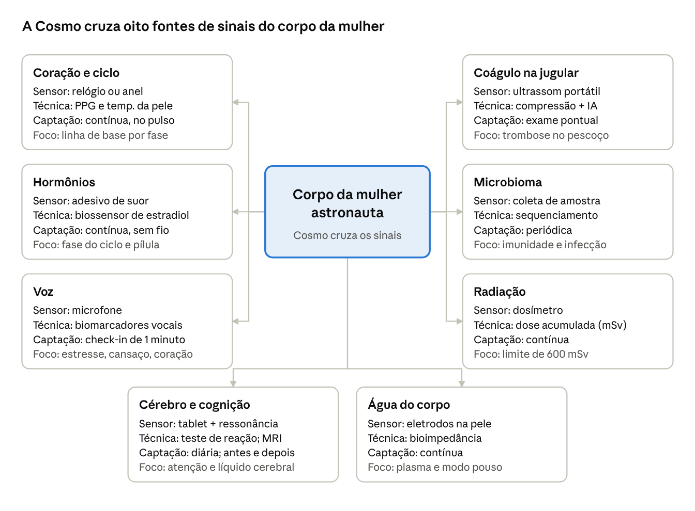

# Pesquisa: saúde da mulher astronauta

Equipe NEXUS SATURN · NASA Space Apps 2026 · Levantamento de 12/11/2026, por Evelyn.

Pesquisa para o AstroHealth OS e a Cosmo: o que a NASA já usa, as lacunas sobre o corpo da mulher, os artigos de base, as ideias e onde a proposta entra no que o time já construiu. Versões editáveis no Drive da equipe: [documento](https://docs.google.com/document/d/1vBVbXAm7aBizQpK-qhOnOxRp0RgYUtrePWPlO9cZ5rQ/edit) e [planilha de alertas por sexo e exercícios](https://docs.google.com/spreadsheets/d/15VCHlDxIiKIoJNxjylkuOfWaXOY-AVguT1SZu40j4RE/edit).

## 1. O que a NASA já usa hoje

- **Actiwatch** (relógio de pulso): usado em pesquisas na Estação Espacial para acompanhar sono e ritmo circadiano. Fonte: [NASA – Wearable Tech for Space Station Research](https://www.nasa.gov/missions/station/iss-research/wearable-tech-for-space-station-research/)
- **Bio-Monitor** (Agência Espacial Canadense): camisa inteligente com sensores de pulso, pressão, respiração e temperatura da pele; dados enviados à Terra. Fonte: [CSA – Bio-Monitor](https://www.asc-csa.gc.ca/eng/sciences/bio-monitor.asp)
- Nenhum dos dois considera ciclo menstrual ou uso de hormônio na análise.

## 2. Brechas apontadas pela literatura

1. **Estabilidade:** sensores podem falhar ou medir errado por microgravidade, radiação e variações de temperatura.
2. **Privacidade:** dados de saúde vão para equipes na Terra; a astronauta nem sempre controla quem vê.
3. **Integração:** cada aparelho gera dados em formato diferente.
4. **Processamento a bordo:** análise autônoma ainda é limitada (em Marte, a comunicação pode levar cerca de 20 minutos).
5. **Durabilidade:** aparelhos precisam aguentar missões de anos.
6. **Falta de dados por sexo:** a principal brecha para a Cosmo.

Fontes: [Revisão – dispositivos vestíveis flexíveis](https://www.sciencedirect.com/science/article/pii/S2950235725000083) · [Revisão – monitoramento em missões de espaço profundo](https://www.sciencedirect.com/science/article/abs/pii/S221455242500080X)

## 3. A NASA reconhece o problema

- Artigo de 2025 com autores da sede da NASA e do Johnson Space Center: "A moonshot for female astronaut health". Diz ser crítico garantir a saúde, a segurança e o desempenho das mulheres em missões longas. [npj Microgravity, 2025](https://www.nature.com/articles/s41526-025-00495-8)
- A NASA fez revisão de estudos de voo e repouso na cama para mapear lacunas na saúde da astronauta. [NASA NTRS](https://ntrs.nasa.gov/api/citations/20230002457/downloads/IEEE_strock_female%20astronaut_FINAL_2.pdf)
- Revisão de 2026: astronautas mulheres relatam mais enjoo espacial. [Experimental Physiology, 2026](https://physoc.onlinelibrary.wiley.com/doi/full/10.1113/EP091527)
- **Conclusão:** há pesquisa e revisões, mas não encontramos ferramenta que monitore isso em tempo real. A Cosmo responde a uma prioridade declarada pela NASA.

### Leitura a fundo: "A moonshot for female astronaut health" (2025)

Autores da NASA e a astronauta Serena Auñón-Chancellor. [npj Microgravity, 2025](https://www.nature.com/articles/s41526-025-00495-8)

- **Diagnóstico:** a maior parte dos dados sobre riscos do voo espacial vem de homens; há muito menos dados sobre mulheres.
- **Tontura pós-voo:** mais comum nas mulheres, mas pode haver fatores não ligados ao sexo (ex.: baixa resistência dos vasos). No pitch, falar em fatores individuais, não só em sexo.
- **O que não se sabe:** como o eixo hormonal do ciclo funciona no espaço; risco de falência precoce dos ovários; se o uso de hormônio aumenta ou diminui riscos de sangramento, anemia, cistos, perda óssea e trombose.
- **Recomendações:** usar IA, ômicas, biorrepositórios e parcerias entre governo e empresas; as próprias astronautas devem participar da definição da pesquisa e liderar a proteção de dados sensíveis de saúde reprodutiva.
- **Para a Cosmo:** privacidade sozinha é básica. O diferencial é o consentimento controlado pela astronauta e a geração de dados separados por sexo, exatamente o que o artigo pede.

### Pesquisas em andamento (2026)

- **Coagulação:** estudo canadense com 18 mulheres em 5 dias de imersão seca (simula microgravidade). O início da coagulação atrasou, mas o coágulo se formou mais rápido e estável. Hormônios menstruais **não** tiveram efeito: o risco parece vir da microgravidade, não do ciclo. Pede protocolos de monitoramento para missões de 6 meses ou mais. [SFU, 2026](https://www.sfu.ca/sfunews/stories/2026/03/sfu-study-sheds-light-on-clotting-risks-for-female-astronauts.html) · [Phys.org](https://phys.org/news/2026-03-female-astronauts-clotting-day-weightlessness.html)
- **Microbioma:** em voos parabólicos com 4 mulheres, a flora vaginal mudou mais que a oral e o cortisol subiu. [Phys.org, 2026](https://phys.org/news/2026-08-clues-space-affect-women-health.html)
- **Ultrassom e voz:** Begum Mathyk (USF) fez os primeiros ultrassons ginecológicos em microgravidade e colabora na avaliação de biomarcadores de voz para medicina espacial; também estuda fertilidade com chips de tecido. Valida as ideias 9 (voz) e 19 (ultrassom guiado). [USF Health, 2026](https://www.usf.edu/health/news/2026/usf-health-research-reveals-new-clues-about-how-space-travel-may-affect-womens-health.aspx)
- **Revisão 2026:** recomenda estudar em missões futuras inflamação, coagulação e leptina após privação de sono, intolerância ortostática, atrofia muscular e perda óssea mais intensas, infecção urinária e câncer por radiação. [Experimental Physiology](https://physoc.onlinelibrary.wiley.com/doi/full/10.1113/EP091527)

### Radiação: o limite que mudou

- Até 2022, o limite de radiação na carreira variava por sexo e idade: de 180 mSv (mulher de 30 anos) a 700 mSv (homem de 60). Na prática, mulheres podiam ficar menos tempo no espaço. [Space.com](https://www.space.com/why-astronauts-radiation-levels)
- Desde 2022, o limite é de 600 mSv, universal para todas as idades e sexos. [NASA-STD-3001](https://www.nasa.gov/wp-content/uploads/2023/03/radiation-protection-technical-brief-ochmo.pdf)
- O valor foi calculado com base na mulher de 35 anos, o caso de maior risco. [Frontiers / PMC](https://pmc.ncbi.nlm.nih.gov/articles/PMC11440919/)
- **Para a Cosmo:** a regra ficou igual, mas os corpos continuam diferentes. Ideia: um painel com a dose acumulada de cada astronauta ao lado dos dados de saúde dela.

### Fronteira: voz como sinal vital

- Maio/2026: estudo da USF com vozes gravadas em voo parabólico, "Vocal Biomarkers for Precision Space Medicine", apresentado num simpósio com hackathon. [IIAS – Center for Space Medicine](https://astronauticsinstitute.org/center/space-medicine)
- Base: mudanças na fala, respiração e qualidade da voz dão pistas sobre Parkinson, Alzheimer, depressão, insuficiência cardíaca e diabetes tipo 2; a voz capta vários sistemas do corpo e da mente ao mesmo tempo. [USF Health, 2026](https://www.usf.edu/health/news/2026/predicting-disease-through-voice-recordings-and-ai-experts-establish-standards-for-vocal-biomarkers.aspx)
- Maio/2026: trabalho rumo a um modelo de base para biomarcadores clínicos de voz. [medRxiv](https://www.medrxiv.org/content/10.64898/2026.05.28.26354346v1)
- **Ideia para a Cosmo:** check-in falado de 1 minuto por dia, cruzado com relógio e ciclo. Ninguém juntou os três ainda.

**Detalhes da voz**

- **Quem pesquisa:** Yael Bensoussan e Jamie Toghranegar (USF Health Voice Center), com Begum Mathyk; estudo de viabilidade no voo parabólico IIAS02, apresentado no Voice AI Symposium & Hackathon (maio/2026). [IIAS](https://astronauticsinstitute.org/center/space-medicine)
- **Padrões em construção (2026):** especialistas estão definindo padrões para biomarcadores vocais, que devem em breve ser usados em diagnóstico e monitoramento. [USF Health](https://www.usf.edu/health/news/2026/predicting-disease-through-voice-recordings-and-ai-experts-establish-standards-for-vocal-biomarkers.aspx)
- **Limite atual:** os biomarcadores costumam ser criados para uma doença de cada vez, o que dificulta generalizar entre condições e locais de gravação. O consórcio Bridge2AI-Voice trabalha num modelo de base para resolver isso. [medRxiv, maio/2026](https://www.medrxiv.org/content/10.64898/2026.05.28.26354346v1)
- **O que se mede na voz (aproximado, sem fonte aberta):** tom, variação do tom, estabilidade, ritmo da fala, pausas e respiração.
- **Como aplicar na Cosmo:**
  - Captação: microfone do fone ou do tablet da nave, num check-in curto com frase fixa todo dia.
  - Análise: comparar com a linha de base da própria astronauta, cruzando com a fase do ciclo e os dados do relógio.
  - Privacidade: a voz identifica a pessoa, então o processamento deve ser feito a bordo, e só os indicadores saem, com o consentimento dela.
  - Pitch: a voz é o sensor mais barato e menos invasivo; a Cosmo seria a primeira a juntar voz, relógio e ciclo.

**Consenso VOCAL (jul/2026)**

- Primeira estrutura de consenso com definições para biomarcadores vocais, publicada na *Digital Biomarkers*; 24 especialistas da Europa e da América do Norte. [USF Health](https://www.usf.edu/health/news/2026/predicting-disease-through-voice-recordings-and-ai-experts-establish-standards-for-vocal-biomarkers.aspx) · [Artigo](https://karger.com/dib/article/doi/10.1159/000553327/953035/Consensus-Based-Definitions-for-Vocal-Biomarkers)
- Problema: "biomarcadores de voz", "de fala" e "vocais" eram usados como sinônimos, embora sejam processos diferentes.
- A estrutura separa **medidas vocais** de **biomarcadores vocais validados** e cria um modelo hierárquico dos domínios da produção de voz e fala.
- Grupos: [eVoiceNet](https://evoicenet.eu/) (Europa, coordenada pelo Instituto de Saúde de Luxemburgo) e [Bridge2AI-Voice](https://b2ai-voice.org/) (EUA, financiado pelo NIH e codirigido pela USF).
- **Para o pitch:** no começo, a Cosmo capta medidas vocais, não biomarcadores validados. Usar o termo certo mostra domínio do estado da arte.

### Leitura a fundo: coágulos e a veia jugular (SFU + ESA, 2026)

- Estudo VIVALDI I (ESA): 18 mulheres, 5 dias de imersão seca; medido por tromboelastometria rotacional (ROTEM). Publicado na Acta Astronautica. [SFU News](https://www.sfu.ca/sfunews/stories/2026/03/sfu-study-sheds-light-on-clotting-risks-for-female-astronauts.html) · [Artigo](https://doi.org/10.1016/j.actaastro.2025.11.065)
- Resultado: a coagulação demora mais para começar, mas, depois, forma coágulos mais rápidos, mais fortes e difíceis de dissolver. Não preocupante em 5 dias, mas pede mais estudo para missões longas.
- **Onde o coágulo se forma:** sem gravidade, o sangue se acumula na cabeça e pode até inverter o fluxo; por isso, no espaço, os coágulos tendem a surgir na **veia jugular**, perto do pulmão e do coração. Na Terra, costumam surgir nas pernas.
- Hoje as tripulações fazem ultrassom da jugular regularmente, mas só de tempos em tempos.
- **Brecha:** os dados equivalentes de homens ainda estão sendo analisados; a comparação entre os sexos não saiu.
- **Para a Cosmo:** o sensor certo fica no pescoço, não na perna. Um colar ou adesivo acompanha a circulação da jugular entre um ultrassom e outro e avisa quando antecipar o exame.

### Leitura a fundo: microbioma e ultrassom (USF, Begum Mathyk)

- **Microbioma (ago/2026):** primeira evidência de que gravidade alterada e estresse do voo afetam significativamente o microbioma vaginal, com efeito mínimo no oral; o cortisol subiu. 4 mulheres em voo parabólico. [USF Health](https://www.usf.edu/health/news/2026/usf-health-research-reveals-new-clues-about-how-space-travel-may-affect-womens-health.aspx) · [Frontiers in Microbiology](https://www.frontiersin.org/journals/microbiology/articles/10.3389/fmicb.2026.1817099/full)
- Por que importa: o desequilíbrio está ligado a inflamação, infecção e resposta imune alterada; o microbioma também é visto como biomarcador não invasivo para doenças ginecológicas, câncer, gravidez e monitoramento de saúde. Pede estudos longitudinais em missões longas.
- **Ultrassom portátil (2025):** ultrassom ginecológico com aparelho de mão, testado em voo parabólico (Obstetrics & Gynecology).
- **DIU e implante (jun/2026):** viabilidade de inserir e retirar DIU e implante em microgravidade, com treinamento feito na hora. [IIAS – Center for Space Medicine](https://astronauticsinstitute.org/center/space-medicine)
- **Para a Cosmo:** o microbioma pode virar mais um sinal monitorado; os estudos de ultrassom e de treinamento na hora reforçam a ideia de a IA guiar a astronauta em exames.

### Atenção: ultrassom guiado por IA já existe

- ESA: projeto de IA para astronautas fazerem ultrassom sozinhas com qualidade próxima à de especialista. [ESA](https://www.esa.int/Enabling_Support/Space_Engineering_Technology/Just_add_AI_for_expert_astronaut_ultrasound)
- EchoFinder-2: astronautas fizeram ultrassom nos próprios órgãos na estação, com IA e realidade aumentada. [Wisevoter, out/2026](https://wisevoter.com/world/2026/10/02/astronauts-conduct-space-medical-imaging-tests)
- AMOS (NASA): software de instrução na hora; tripulantes fizeram ultrassom de bexiga e rim sem ajuda da Terra. [PubMed](https://pubmed.ncbi.nlm.nih.gov/41778279/)
- Eslovênia: detecção autônoma de trombose, com teste previsto na estação entre 2028 e 2029. [Univ. de Ljubljana](https://www.fs.uni-lj.si/en/press-releases/slovenian-technology-enables-autonomous-detection-of-venous-thrombosis-in-astronauts/)
- **Reposicionamento:** a Cosmo não guia o exame, ela é o **gatilho**. Monitora o tempo todo, com base de referência por sexo e por pessoa, e indica quando checar a jugular. Complementa essas ferramentas em vez de competir.

### Leitura a fundo: detecção autônoma de trombose (Eslovênia + ESA, jun/2026)

- Universidade de Ljubljana (Faculdade de Engenharia Mecânica, LNMS) com financiamento da ESA; líderes Andrej Bergauer e Janez Urevc. [Univ. de Ljubljana](https://www.fs.uni-lj.si/en/press-releases/slovenian-technology-enables-autonomous-detection-of-venous-thrombosis-in-astronauts/)
- Hoje o diagnóstico depende de ultrassom feito pela astronauta sob orientação direta de médicos na Terra, o que não funciona bem na Lua ou em Marte.
- Solução: ultrassom de compressão + medição da resposta mecânica dos tecidos + IA que identifica a jugular automaticamente; análise feita a bordo. Teste na estação previsto para 2028–2029.
- **Brechas que sobram:** (1) continua sendo um exame pontual, não monitoramento contínuo; (2) não menciona diferenças entre os sexos.
- **Para a Cosmo:** ser o gatilho contínuo e por sexo que indica quando fazer esse exame; citar o projeto como parceiro natural no pitch.

### Cérebro, olhos e cognição

- Estudo da Universidade da Flórida (Rachael Seidler, com a NASA), cerca de 30 tripulantes, 25% mulheres: as mulheres tiveram maior redução de **água livre** (fora das células) perto do topo do cérebro; os homens tiveram mais **achatamento do globo ocular**. [npj Microgravity, 2025](https://pmc.ncbi.nlm.nih.gov/articles/PMC12394539/) · [Earth.com](https://www.earth.com/news/men-and-womens-eyes-respond-differently-to-spaceflight/)
- As consequências funcionais dessa mudança ainda não são conhecidas.
- Cognição: astronautas relatam às vezes névoa mental e lentidão no início da missão, mas em geral se adaptam (conhecimento geral, sem fonte aberta aqui).
- Hormônio: na Terra, o ciclo tem efeitos pequenos e inconsistentes no raciocínio. **Cuidado no pitch:** não dizer que o hormônio atrapalha a mulher de pensar.
- **Brecha:** ninguém estudou a soma das mudanças de líquido no cérebro com o hormônio (natural ou da pílula) no espaço.
- **Para a Cosmo:** teste rápido de atenção e tempo de reação junto ao check-in de voz, para medir em vez de supor.

**Cognição: ferramenta que já existe**

- A NASA tem a bateria **Cognition**: 10 testes neuropsicológicos (emoção, orientação espacial, decisão sob risco etc.). A Cosmo pode usá-la em vez de inventar um teste. [PMC](https://pmc.ncbi.nlm.nih.gov/articles/PMC4691281/)
- Diferenças médias entre os sexos: num estudo com adultos de formação técnica, os homens pontuaram mais em atenção vigilante, raciocínio espacial e tomada de risco [PubMed](https://pubmed.ncbi.nlm.nih.gov/31852569); outra pesquisa achou as mulheres melhores em velocidade de percepção [Frontiers, 2024](https://www.frontiersin.org/journals/psychology/articles/10.3389/fpsyg.2024.1402645/full).
- **Cuidado no pitch:** são médias de grupo, com muita sobreposição, influenciadas por treino e cultura; não dizem nada sobre uma astronauta específica.
- A base de referência da NASA tem 97 astronautas e pessoas de perfil parecido, sendo 35,1% mulheres: ainda é majoritariamente masculina. [NASA NTRS](https://ntrs.nasa.gov/citations/20240010918)
- **Para a Cosmo:** comparar cada astronauta com ela mesma ao longo da missão, e não com uma média, na mesma lógica da linha de base pessoal do coração.

**Cognição feminina no espaço: lacuna aberta**

- Não encontramos estudo dedicado à cognição de astronautas mulheres. Isso é, por si só, uma lacuna.
- Revisão da NASA: o conhecimento vem principalmente de homens; supor que mulheres reagem igual à microgravidade pode ser inadequado e afetar a saúde e o sucesso da missão. [NASA NTRS](https://ntrs.nasa.gov/citations/20220015095)
- Energia e hormônios: exercício intenso e falta de energia podem alterar os hormônios reprodutivos e o ciclo. [ResearchGate](https://www.researchgate.net/publication/370329803_The_Effects_of_Space_Flight_and_Microgravity_Exposure_on_Female_Astronaut_Health_and_Performance)
- Microgravidade e estrogênio: evidências emergentes sugerem que a microgravidade reduz a produção de estrogênio, o que atrapalha a ovulação e o ciclo. [Frontiers in Physiology, 2025](https://www.frontiersin.org/journals/physiology/articles/10.3389/fphys.2025.1558711/full)
- **Raciocínio:** o estrogênio age no cérebro, a microgravidade pode reduzi-lo, e ninguém mediu o efeito disso na cognição das astronautas.
- **Para a Cosmo:** ser a primeira a cruzar hormônio medido pelo suor com teste cognitivo (bateria Cognition).

**Estrogênio e cognição: base científica**

- **Onde age:** há receptores de estrogênio no córtex, no hipocampo e nos neurônios que produzem acetilcolina, serotonina, dopamina e noradrenalina; o estrogênio aumenta a acetilcolina e ajuda a preservar atenção e memória. [Frontiers, 2025](https://www.frontiersin.org/journals/molecular-biosciences/articles/10.3389/fmolb.2025.1634302/full)
- **Energia:** o estradiol aumenta a glicose disponível no hipocampo, o que acompanha seus efeitos positivos na memória. [PubMed](https://pubmed.ncbi.nlm.nih.gov/33982614/)
- **Quando cai (menopausa):** perdas na lembrança imediata e tardia e pequenas quedas de concentração e velocidade, maiores do que o esperado só pela idade. [PMC](https://pmc.ncbi.nlm.nih.gov/articles/PMC5875178/)
- **Compensação:** sem estradiol, o hipocampo fica menos ativo e áreas frontais trabalham mais. [Brain Imaging and Behavior, 2026](https://link.springer.com/article/10.1007/s11682-026-01167-1)
- **Reposição:** em 12 meses de tratamento hormonal na menopausa, houve melhora na névoa mental, concentração, memória de trabalho, velocidade de processamento, memória verbal e resolução de problemas. [Scientific Reports, 2026](https://www.nature.com/articles/s41598-026-65603-4)
- **Para a Cosmo:** se a microgravidade derruba o estrogênio, a astronauta pode entrar num estado parecido com a menopausa, afetando memória de trabalho e velocidade, que são o que a bateria Cognition mede. Hipótese a testar, não fato comprovado.

**E se o estrogênio estiver alto demais?** (conhecimento geral, sem fonte aberta aqui; confirmar antes do pitch)

- Causas comuns na Terra: gravidez, algumas pílulas e tratamentos hormonais, excesso de gordura corporal e, mais raramente, alguns tumores.
- Efeitos: mais risco de coágulo (o estrogênio aumenta fatores de coagulação), retenção de líquido, menstruação mais intensa, mais estímulo ao endométrio a longo prazo, alterações de humor e enxaqueca.
- Cognição: os estudos sugerem uma curva em U invertido, em que a faixa média é a melhor e o excesso não traz ganho extra. Ainda é discutido.
- **No espaço:** a microgravidade já favorece coágulo na jugular; com pílula de estrogênio, os riscos podem se somar.
- **Para a Cosmo:** o adesivo de suor detectaria tanto estrogênio baixo quanto alto, e o dado alimentaria o alerta de coágulo.

### Carta na manga: hormônio pelo suor, em tempo real

- O Caltech (laboratório de Wei Gao) criou um adesivo flexível que mede **estradiol no suor** e envia os dados sem fio ao celular, em tempo real. [Caltech](https://www.caltech.edu/about/news/wearable-patch-wirelessly-monitors-estrogen-in-sweat) · [Nature Reviews Bioengineering, 2025](https://www.nature.com/articles/s44222-025-00276-8)
- Apoio do programa de saúde da mulher da ARPA-H (agência de pesquisa em saúde dos EUA); Wei Gao é cofundador da startup Persperity Health. Em 2026, a Forbes já falava numa corrida pelo monitoramento hormonal contínuo. [Forbes, fev/2026](https://www.forbes.com/sites/josipamajic/2026/02/27/who-is-winning-continuous-hormone-monitoring--and-what-comes-next/)
- **Por que é diferencial:** no espaço, ninguém mede hormônio de forma contínua; hoje seria preciso sangue ou urina. Com o adesivo, a Cosmo mede a fase do ciclo em vez de supor pelo calendário e acompanha o efeito da pílula, que é a lacuna dos artigos.
- Ninguém aplicou isso ao espaço ainda.

### Segunda carta: bioimpedância

- Uma corrente elétrica fraca (já usada em balanças e relógios) estima a água do corpo.
- **Para a Cosmo:** acompanhar a perda de líquido e plasma durante a missão e alimentar o **modo pouso**, que prevê o risco de desmaio na volta.

### Vantagens do corpo da mulher e outros achados

- **Água:** mulheres perdem 29% menos água pelo suor no exercício aeróbico e precisam de menos água para se reidratar. Estimativa divulgada por um jornalista: uma tripulação só de mulheres economizaria cerca de US$ 158 milhões por missão. [Women's Agenda](https://womensagenda.com.au/latest/women-astronauts-were-once-seen-as-a-liability-but-research-suggests-they-could-have-an-edge/)
- **Argumento de negócio:** a Cosmo ajuda a tornar viável a tripulação mais eficiente para Marte.
- **Supressão por décadas:** uma astronauta do Artemis (2025–2035) poderia passar até 20 anos suprimindo a menstruação, o que reforça o monitoramento hormonal de longo prazo. [ZME Science](https://www.zmescience.com/science/news-science/menstrual-cups-in-space-women-astronauts/)
- **Ciclo e tontura:** estudo-piloto testou o efeito das fases do ciclo nas respostas cardiovasculares e autonômicas ao ficar de pé, em realidade virtual da estação, o que conversa com o modo pouso. [Physiologia](https://doi.org/10.3390/physiologia6030050)
- **Mito derrubado:** em testes que simulam o voo, a fase do ciclo não afetou a tendência ao enjoo. [Experimental Physiology, 2026](https://physoc.onlinelibrary.wiley.com/doi/10.1113/EP091527)

## 4. Artigo-base: supressão menstrual em astronautas

Jain & Wotring (2016), *Medically induced amenorrhea in female astronauts*, npj Microgravity. [Acesso aberto](https://www.nature.com/articles/npjmgrav20168)

- **Por que suprimem:** o sistema que recupera água da urina na estação não foi feito para sangue menstrual; higiene e água são limitadas. Mesmo assim, é uma escolha: a estrutura existe para quem quiser menstruar. A supressão é mais comum em missões longas.
- **Osso:** a pílula combinada (30–35 μg de estrogênio) pode até proteger o osso, mas a dose foi definida com estudos feitos na Terra. Não existem estudos comparando perda óssea no espaço entre quem usa e quem não usa pílula. **Lacuna oficial.**
- **Alternativas:** DIU hormonal e implante não têm estrogênio, não afetam o osso na Terra e não geram lixo. A injeção trimestral foi descartada por reduzir a densidade óssea.
- **Escape:** sangramento irregular nos primeiros meses; recomenda-se colocar o DIU de 1,5 a 2 anos antes do voo.
- **Dado militar:** 66% das mulheres queriam suprimir, mas só 21% mantinham o uso contínuo; 86% queriam educação obrigatória sobre o tema.
- **Fertilidade:** depois de parar a pílula, 99% voltam a menstruar ou engravidam em até 3 meses. (Ex.: Valentina Tereshkova teve uma filha no ano seguinte ao voo.) Fertilidade **não** é uma boa brecha para o pitch.
- **Conclusão dos autores:** dar às astronautas informação atualizada e baseada em evidências, respeitando a autonomia delas.

## 5. Outros achados fisiológicos

- **Pós-voo:** as mulheres tiveram mais pré-síncope e maior perda de plasma. Hipóteses: menor volume de sangue de base, efeito hormonal sobre líquidos e vasos, e menor massa muscular nas pernas.
- **Vertigem:** vem do labirinto readaptando à gravidade e é diferente da tontura por pressão.
- **Ciclo × sensores:** depois da ovulação, a frequência cardíaca sobe cerca de 3 bpm e a temperatura da pele cerca de 0,3 °C; a pílula também muda o padrão.
- **Psicológico:** a fase pré-menstrual e o estresse alteram o sono e a variabilidade cardíaca. Quase não há estudos no espaço; apresentar como lacuna.
- **Representatividade:** até 2013, eram 477 homens e 57 mulheres no espaço.

## 6. Ângulo recomendado para o pitch

> Os monitores de saúde espacial foram calibrados em corpos masculinos. O ciclo e os hormônios mudam o que o relógio mede, então o detector erra com as mulheres: dá alarme falso ou deixa passar um sinal real. A Cosmo é o primeiro monitor que entende o corpo da mulher.

- Tratar como **saúde hormonal da astronauta**, cobrindo quem menstrua e quem suprime.
- Tom: falta dado para decidir, não erro das astronautas.
- Diferenciais: linha de base por fase do ciclo ou método hormonal, privacidade controlada pela astronauta, processamento a bordo e dados por sexo com consentimento.
- Usar sensores que já existem (ex.: [Condor Instruments](https://lp.condorinst.com/condor-google-pt)), o que reduz custo e prazo.

## 7. Parte técnica: o que o sistema precisa

A Cosmo precisa de três camadas: sinais do relógio, contexto hormonal e um modelo de linha de base pessoal.

1. **Sinais do relógio:** frequência cardíaca de repouso, variabilidade cardíaca (HRV), temperatura da pele, sono e movimento.
2. **Contexto da astronauta:** fase do ciclo ou método hormonal (pílula, DIU, implante), informado num perfil simples, mais um registro diário rápido de sintomas.
3. **Modelo de linha de base pessoal:** aprende o normal de cada mulher em cada fase e só alerta quando o sinal foge desse normal, para evitar alarme falso todo mês.

**Por que a linha de base não pode ser masculina:** em média, o coração da mulher é menor e bombeia menos sangue por batida; para compensar, bate mais rápido, e a frequência de repouso costuma ser alguns batimentos mais alta. No espaço, o coração também perde um pouco de massa por trabalhar menos, o que pode explicar a menor reserva e a maior perda de plasma e tontura no retorno (hipótese, poucas astronautas estudadas). Um modelo calibrado em homens leria esse normal feminino como alteração.

**Outros fatores que mexem nos dados cardíacos:** estresse, exercício, sono, cafeína, remédios e a própria microgravidade.

Desafio: quase não há dados de astronautas mulheres. Caminho: treinar com dados de mulheres na Terra, mostrar que funciona e deixar claro que, no espaço, o modelo seria recalibrado.

### Base de dados para treinar

- **mcPHASES (PhysioNet, 2025):** 42 participantes, com dados do Fitbit (temperatura da pele, frequência cardíaca, HRV, respiração e sono) e hormônios medidos em casa todo dia, além de sintomas. [PhysioNet – mcPHASES](https://physionet.org/content/mcphases/1.0.0/) · [Artigo na Scientific Data](https://www.nature.com/articles/s41597-026-06805-3)
- O artigo confirma que a frequência cardíaca de repouso é mais baixa na fase folicular, sobe na janela fértil, tem pico na fase lútea e volta ao normal na menstruação. Isso comprova que o relógio “enxerga” o ciclo.
- Ponto de atenção: um projeto no GitHub mostrou que, nessa base, a contagem de dias do ciclo previu a fase melhor que os sinais do relógio. Por isso a Cosmo deve usar os dois juntos, e o foco é calibrar alertas, não adivinhar a fase. [GitHub – womens-health-ml](https://github.com/YaaOppong/womens-health-ml)
- Exemplo de análise pronta com a mesma base: [GitHub – Wearable-Menstrual-Biomarker](https://github.com/Khadijakhanbme/Wearable-Menstrual-Biomarker)
- Complementar: dataset de saúde de astronautas no Kaggle enviado pela Kami (provavelmente simulado; ver abaixo).

### Potencial parceira: Condor Instruments

O actígrafo da Condor já foi aprovado pela NASA e usado na Artemis II, então a Cosmo pode rodar num hardware brasileiro já validado. [Brazil Journal](https://braziljournal.com/a-startup-brasileira-que-chegou-ao-pulso-dos-astronautas-da-nasa/) · [Revista Pesquisa FAPESP](https://revistapesquisa.fapesp.br/wp-content/uploads/2026/05/042-045_artemis_363.pdf) · [Embrapa (clipping)](<https://sistemas.cppse.embrapa.br/clipping/12247_noticia_embrapa%20(41).pdf>)

- **Empresa:** startup paulista fundada em 2013 por ex-alunos da Poli-USP (Rodrigo Trevisan Okamoto e Luis Filipe Rossi), na incubadora Cietec, no campus da USP.
- **NASA:** venceu uma seleção internacional em 2023; os quatro astronautas da Artemis II usaram o modelo ActLumus no pulso, inclusive Christina Koch.
- **O que mede:** movimento (sono e atividade), luz (incluindo a luz melanópica, que afeta a melatonina) e temperatura da pele. Nenhuma das fontes cita sensor de frequência cardíaca.
- **Números:** cerca de US$ 700 no exterior e R$ 3 mil no Brasil; capacidade de 300 aparelhos por mês; faturamento de R$ 6,6 milhões no ano passado e previsão de R$ 10 milhões em 2026.
- **Clientes:** Harvard, Stanford, NIH, NHS, United Airlines, Air Canada e FedEx; cerca de 90% das vendas vão para o exterior.
- **Próximos passos dela:** nova versão com sensor de luz melhor, um wearable para o ritmo circadiano interno e possível missão ao polo sul da Lua em 2028.
- **Para a Cosmo:** a temperatura da pele sobe cerca de 0,3 °C depois da ovulação, e o ActLumus já mede isso. A Cosmo seria o software que entende o corpo da mulher em cima desse hardware, o que reduz custo e prazo. Falta o sinal cardíaco, que viria de outro sensor. No pitch, dizer "potencial parceira": não há parceria fechada.

### Cuidado com o dataset do Kaggle

- Dados individuais de astronautas da NASA não podem ser baixados: são protegidos pela Privacy Act e só saem por pedido formal, com revisão. [NASA NTRS](https://ntrs.nasa.gov/api/citations/20170009502/downloads/20170009502.pdf)
- Por isso, um dataset de "saúde de astronautas" postado por um usuário no Kaggle quase certamente é simulado. Conferir se a página tem a etiqueta "synthetic".
- **Uso certo:** demo e protótipo, nunca como prova no pitch.

### Bases reais que dá para citar

- **Inspiration4 (EXPAND):** primeiro banco de acesso aberto com dados de saúde de astronautas comerciais. [Solar Daily](https://www.solardaily.com/reports/NASAs_Repository_Advances_Research_on_Commercial_Astronaut_Health_999.html)
- **Pressão arterial no espaço (Mendeley):** dados resumidos de estudos e da NASA, com sexo, IMC, idade e uso de contramedidas. Bom para comparar homens e mulheres. [Mendeley Data](https://data.mendeley.com/datasets/pz6nt4cpxs)
- **ASPA:** arquivo de astronautas e participantes de voo de 1959 a 2023, com dados biográficos e de missão, licença aberta. [GitHub – ASPA](https://github.com/osmed-admin/aspa)
- **mcPHASES:** a base acima, para treinar o modelo do ciclo.

### Concorrentes no Space Apps 2026

- Há times com monitores de saúde de astronautas parecidos, todos com dados sintéticos e sem foco em mulheres: [ASTRA-PULSE](https://github.com/JennyZhang9/SpaceBaguette.github.io) usa um CSV do Kaggle com 374 perfis sintéticos; [AstroByte Health Monitor](https://github.com/meahadi-hasan/AstroByte-Health-Monitor) mostra frequência cardíaca, oxigênio e temperatura sintéticos.
- **Diferencial da Cosmo:** dados reais de mulheres (mcPHASES) e o recorte de saúde da mulher.

## Mapa: o corpo da mulher no centro

À esquerda, os sinais ligados ao próprio corpo (coração, hormônios, voz); à direita, os riscos do ambiente espacial (coágulo, microbioma, radiação); abaixo, cérebro e cognição e água do corpo (bioimpedância). A Cosmo é o centro que cruza todos.

## Ideias fora da caixa

1. **Gêmea digital:** cada astronauta tem uma cópia virtual do próprio corpo, alimentada pelos dados do relógio; antes de uma tarefa crítica, o sistema simula como ela vai responder naquele dia.
2. **Modo pouso:** semanas antes do retorno, a Cosmo prevê o risco de desmaio de cada uma e sugere líquidos, sal e exercícios personalizados.
3. **Escala inteligente da tripulação:** sugere em que momento cada pessoa está no seu melhor, homem ou mulher, para planejar caminhadas espaciais e tarefas de risco.
4. **Laboratório vivo:** cada missão vira pesquisa; com consentimento, dados anônimos alimentam um banco aberto que hoje não existe. A astronauta deixa de ser só paciente e vira cientista.
5. **Ponte com a Terra:** a mesma tecnologia para mulheres em ambientes extremos (plataformas de petróleo, Antártida, militares), ampliando mercado e impacto.

### Rodada 2 – mais ousadas

6. **Sensor no lugar do relógio:** anel ou adesivo que mede hormônios pelo suor, dispensando exame de sangue no espaço.
7. **Ciclo como relógio biológico da nave:** em Marte não há o dia da Terra; o ritmo hormonal de cada uma vira calendário interno para ajustar luz, sono e alimentação.
8. **Cardápio adaptativo:** comida ajustada à fase do ciclo ou ao hormônio (ex.: mais ferro com risco de anemia, mais cálcio para o osso).
9. **Voz como sinal vital:** um minuto de conversa diária com o assistente da nave detecta cansaço, estresse e alterações hormonais.
10. **Coleta de dados de mulheres na Terra:** versão gratuita da Cosmo para mulheres comuns cria a maior base de dados do tema, treina o modelo antes da missão e financia o projeto.

### Rodada 3 – criatividade no máximo

11. **Tripulação que se monitora junta:** os relógios conversam entre si; se o estresse de duas pessoas sobe ao mesmo tempo, a Cosmo antecipa um conflito.
12. **Gravidade sob medida:** em naves futuras com gravidade artificial, cada astronauta recebe a dose de gravidade de que o corpo precisa.
13. **Previsão do futuro do corpo:** antes de escolher a tripulação de Marte, simular como osso, coração e hormônios de cada pessoa estariam após três anos de missão, como ferramenta de seleção.
14. **Mãe no espaço:** começar hoje a base de dados que um dia permitirá a primeira gestação segura fora da Terra, como legado para a colonização.

### Rodada 4 – continuando a linha

15. **Caixa-preta do corpo:** grava os sinais vitais o tempo todo para que os médicos reconstruam, minuto a minuto, o que aconteceu num incidente.
16. **Treino que muda com o hormônio:** carga de exercício ajustada à fase do ciclo para proteger osso e músculo.
17. **Remédio na dose certa:** homens e mulheres metabolizam remédios de forma diferente, e no espaço isso muda mais; a Cosmo calcularia a dose ideal por pessoa.
18. **Alerta de trombose silenciosa:** combinar inchaço, temperatura e movimento para avisar de um coágulo antes dos sintomas (já houve uma trombose em missão).
19. **Localizar o coágulo:** um relógio sozinho não localiza. Caminho viável: (a) comparar os dois lados do corpo com sensores leves nas pernas ou num colar, porque o lado com coágulo tende a ficar mais quente, inchado e com circulação diferente; (b) a Cosmo aponta a região suspeita e uma IA guia a própria astronauta a fazer o ultrassom que já existe na estação, como no caso da trombose no pescoço. Pitch: a Cosmo suspeita, aponta a região e guia o exame.

## 8. Pendências

- Levar à Kami o pacote mínimo da seção 9 (dados de 28 dias, M3 por fase do ciclo e resposta da banca).
- Buscar o estudo de 60 dias de repouso na cama e os estudos de trombose com pílula para citar.

## 9. O que o repositório da equipe já tem

O projeto se chama AstroHealth OS, e a Cosmo é a IA de bordo que explica as sugestões. Quem decide é um motor de regras, sempre com um humano no controle. Fonte: [repositório nexus-saturn](https://github.com/KamyllaJawad/nexus-saturn), versão de 12/11/2026.

- **Telas:** relógio, painel de bordo, celular da família e console de Houston. Na demo, a tripulação é Sarah (comandante), Elena (engenheira de voo), Kenji (especialista de missão) e Dr. Marcus (oficial médico): metade é mulher.
- **Modelos:** o M1 detecta fibrilação atrial no ECG (PhysioNet CinC 2017); o M2 avalia a qualidade do sinal; o M3 aprende o normal de cada tripulante com z robusto (mediana e MAD por sinal) e um Isolation Forest por tripulante ([ADR-012](../4-arquitetura/adr/0012-linha-de-base-com-isolation-forest.md)).
- **Metas:** menos de 1 alarme falso por tripulante por semana; o Isolation Forest é calibrado para no máximo 1 alarme por pessoa por dia simulado.
- **Dados:** vitais sintéticos de 14 dias por tripulante, uma leitura por minuto (tarefa D-02 em [5-plano-do-time](../5-plano-do-time/issues-astrohealth.csv)).
- **Privacidade:** consentimento por tipo de dado (sinais vitais, saúde mental, localização) e por destinatário ([ADR-007](../4-arquitetura/adr/0007-consentimento-saude-mental.md)).
- **Condor:** já tem ficha em [7-pitch/parcerias.md](../7-pitch/parcerias.md). Lá a exportação aparece como cerca de 80% e 200 a 300 unidades por mês; o Brazil Journal fala em 90% e até 300 por mês. Alinhar os números antes do pitch.
- **Lacuna:** nenhum requisito, modelo, campo do banco ou tipo de consentimento trata de sexo, ciclo ou hormônio. Só as telas originais, feitas no Stitch, citavam ciclo menstrual.

### Onde a proposta entra

1. **Dados simulados:** 14 dias não cobrem um ciclo. Gerar 28 dias para Sarah e Elena, com a frequência cardíaca cerca de 3 bpm mais alta e a temperatura da pele cerca de 0,3 °C mais alta depois da ovulação.
2. **M3:** uma mediana que ignora a fase dá alarme na fase lútea ou fica larga demais e esconde um problema real. Calcular o normal por fase do ciclo, ou usar a fase como variável, ajuda direto a meta de alarmes falsos.
3. **Banco e consentimento:** incluir o método hormonal no perfil (ciclo natural, pílula, DIU ou implante) e um tipo de consentimento "saúde reprodutiva", como pede o artigo da NASA de 2025.
4. **Pitch:** um slide e uma resposta pronta para "e as mulheres da tripulação?" (seção 10).

Pacote mínimo sugerido para o fim de semana: itens 1, 2 e 4. O item 3 fica como próximo passo.

## 10. Respostas para a banca

### Se elas suprimem a menstruação, por que monitorar o ciclo?

Nem todas suprimem, e a supressão nem sempre é perfeita: pode haver escape. Quem usa hormônio também muda o padrão que o relógio mede e tem riscos de osso e coágulo a acompanhar. Em missões de anos, a supressão pesa na logística: uma missão de três anos com pílula diária exigiria cerca de 1.100 comprimidos, mais embalagem e descarte ([Ecoticias](https://www.ecoticias.com/en/menstruation-has-been-a-part-of-astronauts-space-travel-for-decades-but-in-2027-it-could-for-the-first-time-become-the-focus-of-a-specific-experiment-conducted-in-microgravity-conditions/34129/)). Por isso o módulo é de saúde hormonal e serve para quem menstrua e para quem suprime.

### Ser mulher é uma desvantagem no espaço?

É uma diferença. Os homens têm mais alterações nos olhos (SANS), e as mulheres gastam menos recursos: num estudo da ESA publicado na Scientific Reports, uma tripulação de quatro mulheres precisaria de 1.695 kg a menos de comida numa missão de 1.080 dias, e as mulheres consomem menos oxigênio e água ([FOX 13](https://www.fox13news.com/news/future-space-missions-should-be-conducted-with-all-female-crew-study-suggests)). O problema é que a medicina espacial foi montada com dados de homens. Em 2019, a NASA cancelou a primeira caminhada espacial só de mulheres porque só um traje de tamanho médio estava pronto ([Phys.org](https://phys.org/news/2019-03-nasa-scraps-all-women-spacewalk-lack.html)).

### A pílula faz mal à astronauta?

O certo é dizer que o risco no espaço é desconhecido. Na Terra, a pílula é considerada segura para a maioria das mulheres, e o risco mais conhecido é a trombose. No espaço, a microgravidade também mexe com a circulação e os ossos, e ninguém mediu o efeito dos dois juntos por anos (seção 4). Tom do pitch: falta dado para decidir, e não erro das astronautas.

### Por que a astronauta precisa entender o próprio ciclo?

Para planejar: se ela sabe que em certos dias dorme pior ou se cansa mais, pode deixar tarefas críticas para outro momento e avisar a equipe. E para ter autonomia longe da Terra, sabendo quando uma variação é normal e quando pede atenção. A Cosmo também separa estresse de ciclo, porque os dois mexem na frequência cardíaca, na variabilidade cardíaca e no sono.

### Alguém já estuda menstruação no espaço?

Sim, mas não como monitoramento. A missão Operation Period-01 (OP-01), da ONG Operation Period, vai estudar o fluxo menstrual e o desempenho de absorventes num voo suborbital da Virgin Galactic em 2027, como o primeiro estudo dedicado ao tema ([Space.com](https://space.com/space-exploration/human-spaceflight/menstruation-in-space-will-be-studied-for-1st-time-with-operation-period) · [Stylist](https://www.stylist.co.uk/news/what-happens-to-your-period-in-space/1120520)). Ela não acompanha o ciclo da astronauta no dia a dia, que é o papel da Cosmo.

### Por que treinar com dados de mulheres na Terra?

Porque quase não há dados de astronautas mulheres. A base mcPHASES mostra que o relógio enxerga o ciclo; no espaço, o modelo seria recalibrado. É o mesmo argumento que o time já usa para o CinC 2017 no M1.
